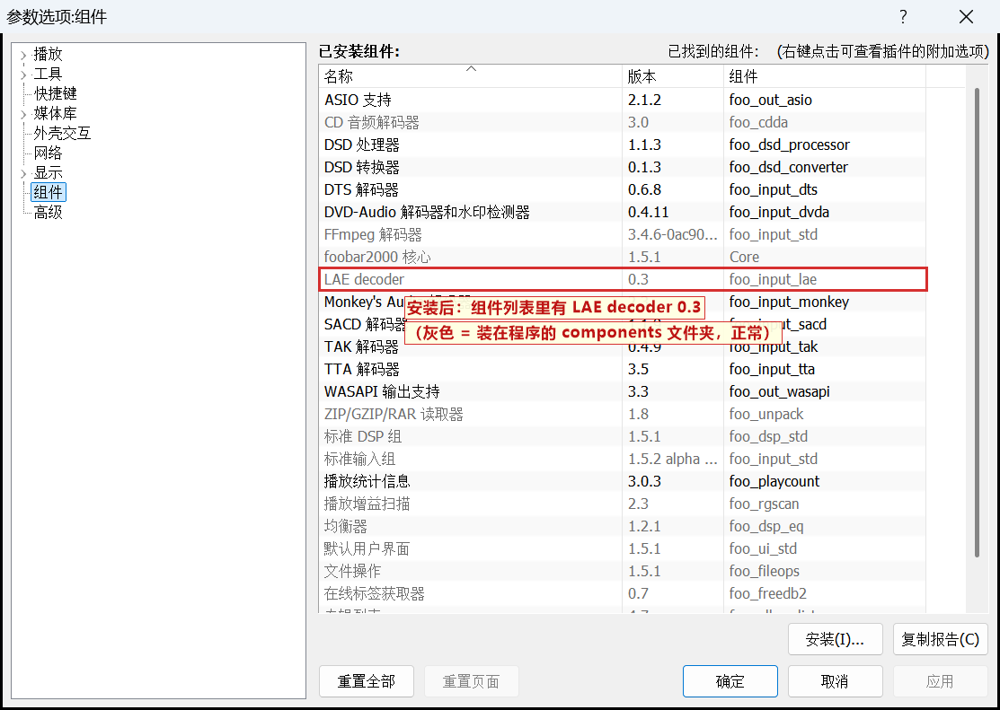
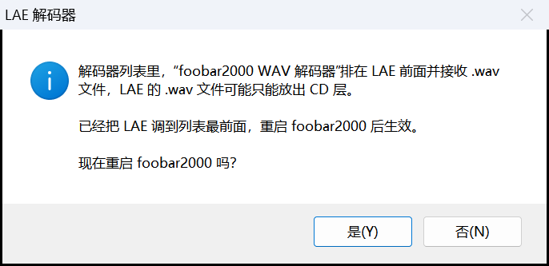
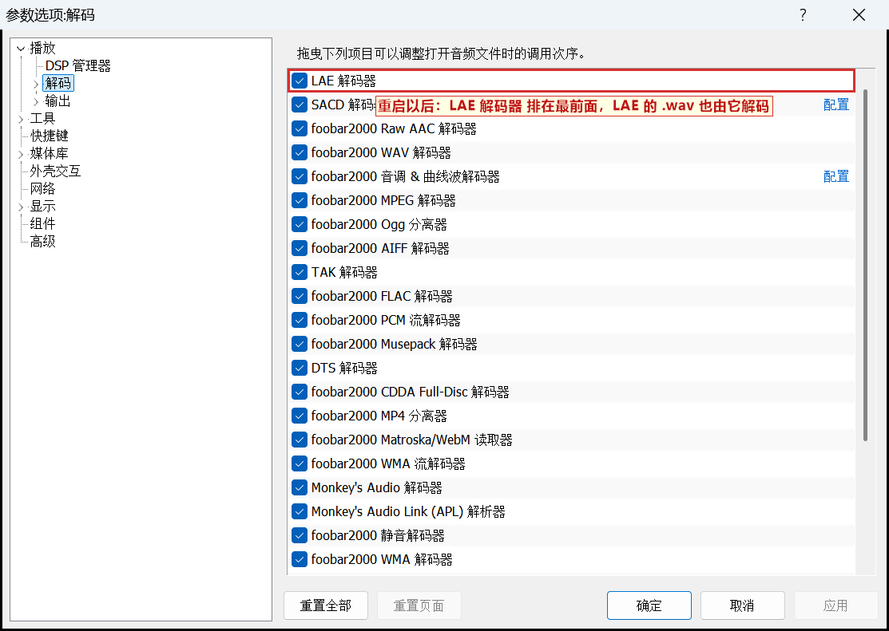
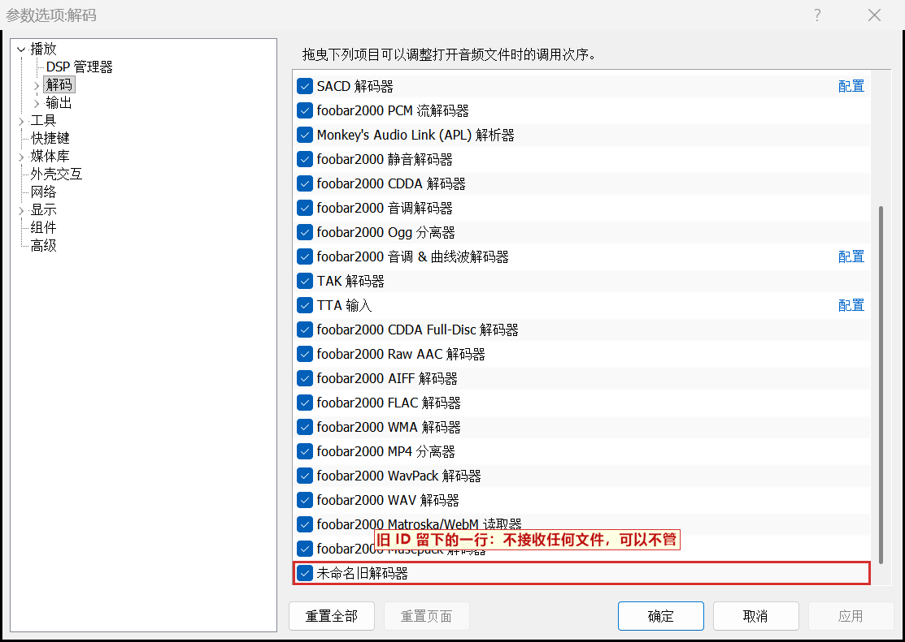
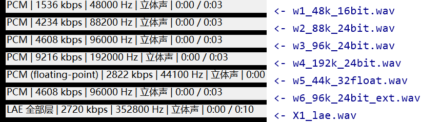
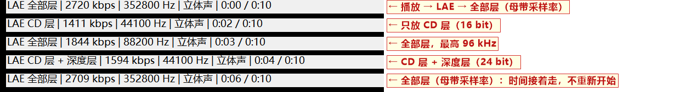
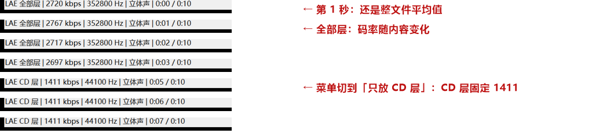
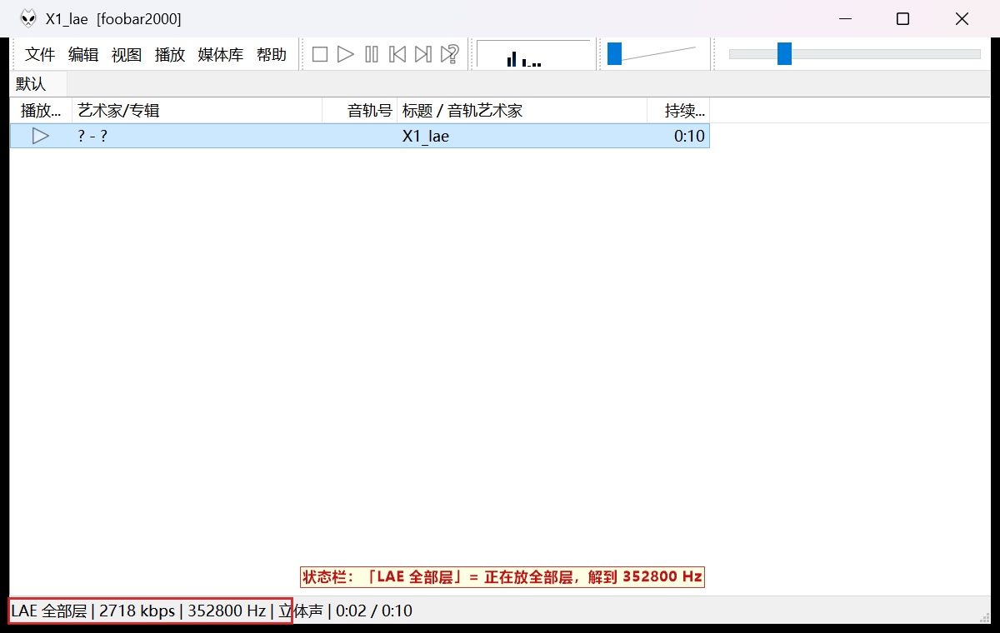
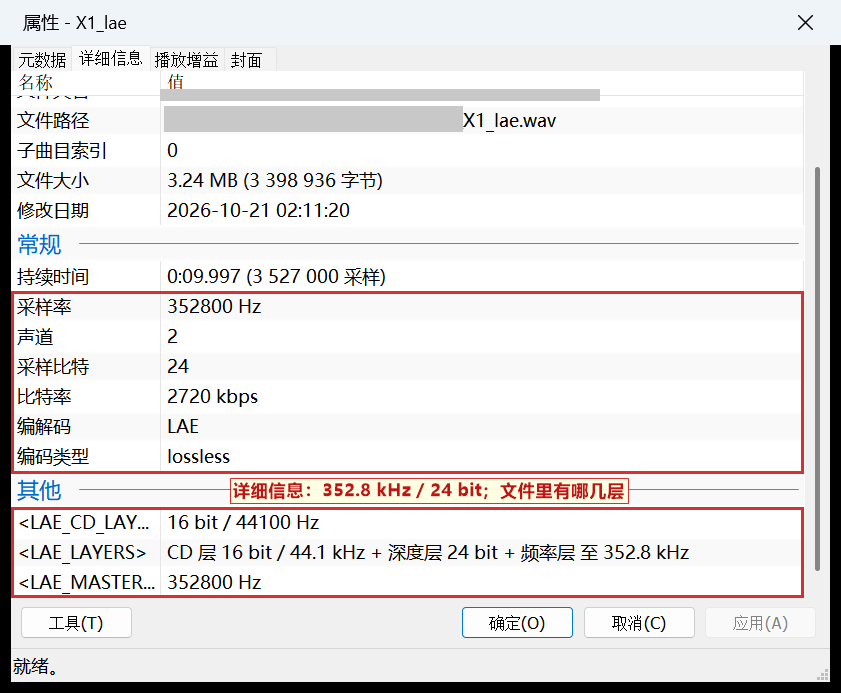
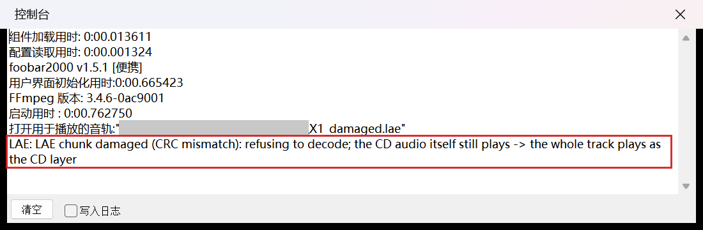

# foo_input_lae: LAE decoder component for foobar2000

**English** | [中文](README.zh.md)

Plays both LAE formats in foobar2000:

- **LAEY** (LAE v5, lossy extension, ID `LAE1`): the CD layer together with the depth layer and the frequency layer, decoded up to the master rate (for example 352.8 kHz / 24 bit).
- **LAES** (LAE Lossless, ID `LAE2`): the core master (can be CD-compatible), or one of the lossless masters (16/24/32 bit, 44.1/48 kHz × 1, 2, 4 or 8), or a rate level of a master. A master plays as that master only after its SHA-256 has been checked (see [LAES](#laes-lossless)).

A WAV or FLAC file without an LAE extension is refused at once and passed unchanged to foobar2000's own decoder.

- Hosts: foobar2000 1.4, 1.5 (including the Chinese-localised edition) and 2.x, 32-bit and 64-bit. One package holds both builds; foobar2000 picks the one that fits.
- Files: LAEY: `.wav` (with an `LAE ` chunk after the `data` chunk) and `.lae` (the same file with another extension). LAES: `.wav` (an `LAE ` chunk that begins with `LAE2`) and `.flac` (`LAE2` APPLICATION blocks).
- Decoders: liblae (`src/lae_api.*`) and the LAES decoder (`src/laes_*.h`, `src/laes_api.cpp`) of this repository (Apache-2.0), compiled into the DLL; no other files are needed.

The screenshots are from the Chinese-localised edition of foobar2000 1.5.1 (a clean portable copy holding only the test files). When the system language is Chinese, all texts of the component are Chinese; otherwise they are English. The English texts are given below.

## Installation

Recommended: double-click `foo_input_lae-<version>.fb2k-component` (or Preferences → Components → Install…, choose the file, Apply), and let foobar2000 restart.
foobar2000 takes the x86 DLL from the root of the package or the x64 DLL from its `x64` folder, whichever fits.

To update, install the new package the same way; foobar2000 replaces the old version when it restarts. Do not install an older package afterwards: it replaces the newer one.

By hand (foobar2000 1.x, 32-bit): copy `foo_input_lae.dll` into the `components` folder of foobar2000 and restart it.
The component is listed under Preferences → Components (in grey when placed in the program folder, which is normal).



## Decoder order: automatic, no dragging

An LAE file may be named `.wav`. foobar2000's built-in "foobar2000 WAV decoder" also accepts `.wav`, and whichever of the two decoders comes first in the list receives the `.wav` files.
If the WAV decoder comes first, an LAE `.wav` plays only its CD layer.

- A foobar2000 that has been in use for some time: foobar2000 places a newly installed decoder at the top of the list automatically, and nothing needs to be done.
- A newly installed foobar2000: the initial order of the list is random (in testing, it was different for every new configuration). If the WAV decoder happens to come before LAE,
  the component moves itself to the top when it starts and asks for one restart of foobar2000:

  
  

  How it works: foobar2000 places a decoder it has never seen at the top, so the component then uses its second identity (GUID). The old identity leaves a row at the bottom of the list,
  shown as "未命名旧解码器" ("unnamed old decoder") in the Chinese edition. That row accepts no files and can be ignored:

  

  Answering "No" has the same effect; the change then applies the next time foobar2000 starts.
  The component adjusts the order in two cases only: when it first sees the order of a configuration (set randomly by foobar2000, or an order from a version before 0.3), and later when foobar2000
  places a newly installed decoder that also accepts .wav ahead of LAE (at most three times). If you drag LAE further down yourself, the component does not move it again. The automatic adjustment can be switched off in the advanced settings.
- `.lae` files are accepted only by LAE, whatever the order.
- Plain WAV files are not affected: LAE accepts only files that carry an LAE chunk. It rejects every other .wav (any sample rate and bit depth) at once, and foobar2000's built-in WAV decoder plays it unchanged.
  The picture shows the status bar for 6 plain WAV files and 1 LAE file, with LAE placed before the WAV decoder:

  
- To check it yourself: Preferences → Playback → Decoding. The order is right when "LAE decoder" is above "foobar2000 WAV decoder":

  

## Choosing the layers: menu Playback → LAE

| Menu item | What plays |
|---|---|
| All layers (master rate) | all layers, decoded to the master rate, for example 352.8 kHz / 24 bit (default) |
| All layers, up to 192 kHz | all layers, decoded to the highest rate step not above 192 kHz (352.8 kHz master → 176.4 kHz) |
| All layers, up to 96 kHz | all layers, decoded to the highest rate step not above 96 kHz (352.8 kHz master → 88.2 kHz) |
| CD layer + depth layer (24 bit) | 44.1 kHz / 24 bit |
| CD layer only (16 bit) | the CD unchanged, 44.1 kHz / 16 bit |

A selection made during playback applies at once and continues from the current position; the track does not start again. The first field of the status bar names the layers that play:



The same settings are also under Preferences → Advanced → Decoding → LAE decoder, together with the switch "Put LAE ahead of decoders that also take .wav files (automatically)":


## What is shown during playback

- Status bar: `LAE all layers` / `LAE CD + depth layer` / `LAE CD layer`, followed by the decoded sample rate.
- File properties → Details: sample rate, bit depth and codec LAE; under "Other": `lae_layers` (the layers the file contains), `lae_master` (the master rate) and
  `lae_cd_layer` (the format of the CD layer).
- Bit rate: LAE has a variable bit rate. The CD layer is fixed (1411.2 kbps in the 44.1 kHz family); the extension layers (depth layer + frequency layer) are entropy-coded and take more for complex content and
  less for quiet content. During playback, the status bar shows the bit rate actually used, updated once a second (the CD layer + the extension bytes read in that second); the first second and the file properties show
  the average of the whole file (file size ÷ duration). When only the CD layer plays, it is fixed at 1411. For the test excerpts, the extension layers averaged from about 10 kbps to about 2150 kbps.

  




When the extension is damaged (below, a test file in which one byte was changed on purpose), the whole track plays as the CD layer, the status bar shows "LAE CD layer (extension unusable)", and the console gives the reason:




## LAEY rules (the same as for the reader)

- Before playback, the whole file is checked (the CRC of the extension chunk and the structure of the header and the streams). A file that fails is played entirely as the CD layer, and one line in the console gives the reason;
  the status bar then shows the format that actually plays (44.1 kHz / 16 bit), and the properties gain an entry `lae_route` with the reason.
- Integrity check (components that call the decoder with the testing-integrity flag): a file that can only be played as the CD layer is reported as an error.
- Within a track, the component never switches by itself between the CD layer and the extension; a stream error during playback is reported as an error and stops playback. Only a different selection in the menu changes the layers, at the current position.
- During decoding, the floating-point state is fixed (round to nearest, denormals not flushed to zero, x87 at 53-bit precision); afterwards the x87 and SSE states are restored separately.
- Memory: per track, only the CD layer and the extension block are kept, about the file size (version 0.1 needed 3.6 times that when opening a file). A 32-bit foobar2000 can use at most 4 GB,
  so a 352.8 kHz LAEY track longer than about one hour needs the 64-bit foobar2000 (the x64 build in the same package).
- Seeking: a seek forward past the part not yet played must entropy-decode up to the target. On the test machine (i9-13900HX), this costs about 1.6 s per minute skipped at 352.8 kHz;
  a seek backwards, or into a part already played, is fast. v5 has no seek table; this is a limit of the format itself.

## LAES (lossless)

### What plays

Without a choice for the track, the settings decide: "CD layer only" plays the core master; "CD layer + depth layer" plays the highest choice at the base rate; otherwise the highest rate up to
"Highest output sample rate", then the longest word up to "LAES: highest bit depth". Masters come before rate levels; the derived 16-bit masters (lossless relative to their definition, not relative to their source master) only when nothing else fits.

Right-click a track → **LAES: choose what plays…** to pick the core master, a master or a rate level for this track. The choice wins over the settings, is kept per path (`laes_choices.txt`),
and applies at once during playback: the new choice starts at the current position (a short silence of about 0.2 s, no repeat of what was already heard). "Automatic" returns to the settings.

### Verification: once per file, remembered

- A master plays as that master only after it has been decoded completely and its samples matched the SHA-256 stored in the file. Until then the core master plays, and the console says why.
- The first check decodes **all** masters in one pass, with one progress bar (per cent, elapsed, remaining). Afterwards every choice of this file plays at once.
- The result is remembered by the SHA-256 of the whole file (`laes_verified.txt`), not by the name or the date: an unchanged file is never checked again, even after renaming or moving it;
  a file with one changed byte is checked again. A master that failed stays refused; the core master still plays.
- Before that, every open checks the file itself: SHA-256 of all bytes, CRC-32 of the extension, the core. The SHA-256 uses the CPU's SHA instructions where present (about 1.9 GB/s on the test machine).
- Checking ahead of playback:
  - Files added to the media library are checked in the background, one at a time, at low priority (setting, on by default).
  - Right-click → **Verify LAES (lossless)** checks the selected files at once, with a progress bar; the results appear in the console.

### Switching and seeking

- The file holds no index. While a master is decoded (and once in the background after opening), the player notes where each coded block begins. Every 16th of these positions is kept in the profile folder (`laes_index`), so a file seen before can switch and seek at once; the media file is never changed.
  A jump or a switch then starts at the block that holds the time, instead of decoding from the beginning.
- With "keep the other masters ready" (setting, on by default), a thread of lowered priority keeps a few seconds around the playing position of the other masters decoded, so that a switch is nearly gapless.
- How much is decoded before playback starts depends on the speed: the decoding speed measured on this computer (during playback or the background check) is kept per file and choice
  (`laes_speed.txt`). On a computer fast enough, playback starts after a quarter of a second; on a slower one, enough is decoded first that playback never stops halfway.
  A progress bar "Decoding ahead so that playback does not pause" shows this wait.

### Settings (Preferences → Advanced → Decoding → LAE decoder)

| Setting | Default |
|---|---|
| LAES (lossless): highest bit depth (0 = no limit, 16, 24 or 32) | 0 |
| LAES (lossless): check files in the background when they are added to the media library | on |
| LAES (lossless): keep the other masters ready while playing, for switching without a gap (uses more CPU) | on |

"Layers" and "Highest output sample rate" apply to LAEY and LAES alike.

### Files

Shared by every LAE player of this user (foobar2000, Kodi, DirectShow), in `%APPDATA%\LAE` (0.15; up to 0.14 they were in the foobar2000
profile folder, which is still read): a file checked in one player plays at once in the others.

| File | Contents |
|---|---|
| `laes_verified.txt` | per file SHA-256 and master: `ok` or `fail` (lines are only appended, so players running at once keep each other's results); and hints `file <size> <path> ok` so that a known file is not shown as "to check" |
| `laes_index\<SHA-256>.idx` | per file: every 16th block start of every layer (about 18 kB for a 10-minute file with 4 masters), with the file's SHA-256 and a CRC-32; a file seen before can switch and seek at once, without the background pass. Never written into the media file; a record that does not match is ignored |

In the foobar2000 profile folder (this player's own):

| File | Contents |
|---|---|
| `laes_choices.txt` | the choice per track: `<choice name>` TAB `<path>` (up to 0.10 this file was written beside the profile folder by mistake; 0.11 reads it there once) |
| `laes_speed.txt` | per file SHA-256 and choice (or `all`): the decoding speed as a multiple of real time |
| `laes_debug.log` | only when you create it (an empty file): an event log of LAES playback (open, seek, switch, close) for reporting a playback fault; delete it to turn the log off |

The text files are plain text; deleting one only means that files are checked, chosen or measured again. The decoded audio is kept in a temporary file that Windows deletes when it is closed.

### Memory and speed

- The decoded choice is kept in a temporary file, not in memory, so a 32-bit foobar2000 also plays long hi-res masters.
- The decoder uses all cores (the background check half of them). The x64 build is faster than the x86 build (more registers, 64-bit multiplications); the file check of one test file (937 MB, FLAC) took
  2.0 s on x86 and 1.4 s on x64 on the test machine (i9-13900HX); the FLAC core master is decoded in parallel parts.
- All speed paths give bit-identical output; they are checked against the reference decoder (`tests/laes`).

## Known issue: ESLyric 0.3.6 crashes

The lyrics component ESLyric 0.3.6 (2017), which comes with the Chinese-localised edition, crashes when the track changes, playback stops or foobar2000 closes while online lyrics are still being downloaded:
it accesses freed memory in `foo_uie_eslyric.dll` (`crash reports\failure_*.txt` names `eslyric_manager::_release_all`).
This is unrelated to LAE: it also happens without this component, with plain WAV files only, and it no longer happens once ESLyric is removed. Short test files of 10–15 s trigger it most easily.
Remedy: use a newer version of ESLyric, or remove it for the time being (Preferences → Components, right-click ESLyric, Remove, restart foobar2000).

## Building

Requires two foobar2000 SDKs (not included in this repository):

- x86: `SDK-2019-12-27.7z` (576,451 bytes, SHA-256 `c9fe776096bcf2c5ec6f07788b4036c9146dd857bf3232053c13c1ee317e5ff6`, from https://www.foobar2000.org/downloads/SDK-2019-12-27.7z);
  it keeps the component loadable in foobar2000 1.4 / 1.5.
- x64: `SDK-2026-10-01.7z` (793,738 bytes, SHA-256 `d4c55077336fae81bf8df0259b5b2748fa45ea84132c656ead93eb123cbcdc26`, from https://www.foobar2000.org/SDK).

```bat
plugins\foo_input_lae\build_fb2k.cmd <SDK-2019-12-27 folder> <SDK-2026-10-01 folder> <output folder>
```

The VS2022 Build Tools are used (x86 and x64 compilers). The script builds both DLLs and packs them into `foo_input_lae.fb2k-component` (x86 at the root, x64 in `x64\`).
The old SDK's code is compiled with `/d2notypeopt`, as that SDK instructs; the x64 component with C++20 and `/permissive`, as the new SDK needs.
The decoders use their own verified options: liblae `/fp:precise`, the LAES decoder `/fp:strict` (its reference taps are computed in double).

## Licence

- Source code of this component: Apache-2.0.
- foobar2000 SDKs compiled into the DLLs (x86: 2019-12-27, x64: 2026-10-01): Copyright (c) Peter Pawlowski, BSD-style licence (`sdk-license.txt`; redistributions of source code must retain the copyright notice,
  and the author's name must not be used to endorse products); pfc: zlib licence.
