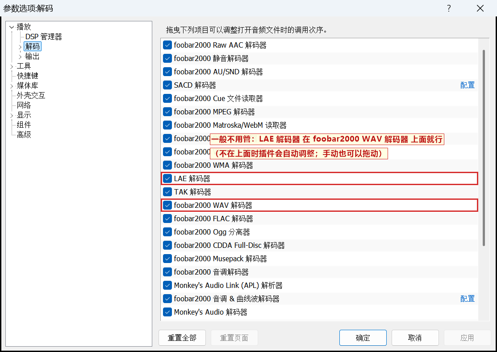
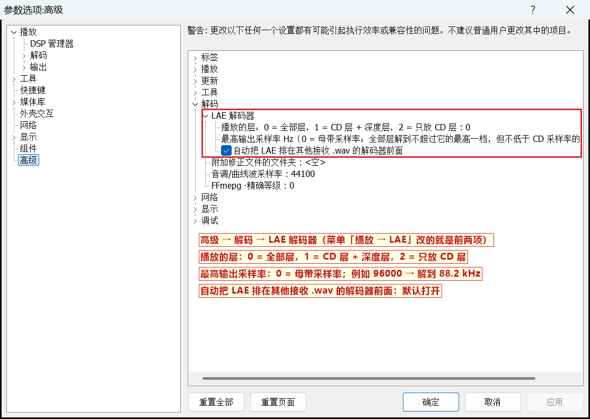
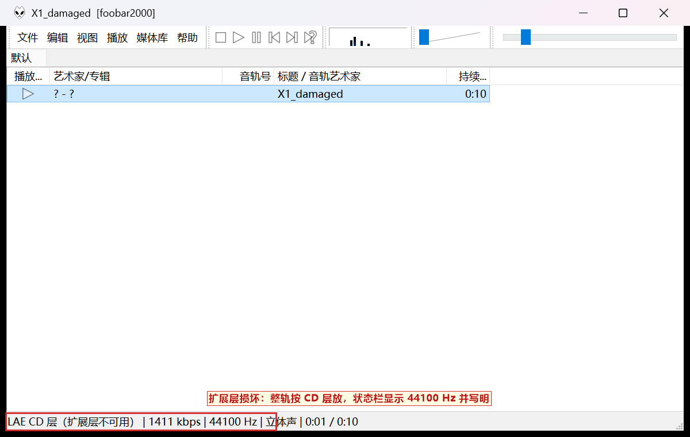

# foo_input_lae: LAE decoder component for foobar2000

**English** | [中文](README.zh.md)

This component plays both LAE formats in foobar2000:

- **LAE Lossy (LAEY)** (LAE container version 5, lossy extension, ID `LAE1`): the CD layer together with the depth layer and the frequency layer, decoded up to the master rate (for example, 352.8 kHz / 24 bit).
- **LAE Lossless (LAES)** (ID `LAE2`): the core master (which can be CD-compatible), one of the lossless masters (16/24/32 bit, 44.1/48 kHz × 1, 2, 4 or 8), or a rate level of a master. A master is played as that master only after its SHA-256 has been checked (see [LAES](#laes-lossless)).

A WAV or FLAC file without an LAE extension is rejected immediately and passed unchanged to foobar2000's own decoder.

- Hosts: foobar2000 1.4, 1.5 (including the Chinese-localised edition) and 2.x, 32-bit and 64-bit. A single package contains both builds, and foobar2000 selects the one that matches.
- Files: LAEY: `.wav` (with an `LAE ` chunk after the `data` chunk) and `.lae` (the same file with a different extension). LAES: `.wav` (with an `LAE ` chunk that begins with `LAE2`) and `.flac` (with `LAE2` APPLICATION blocks).
- Decoders: liblae (`src/lae_api.*`) and the LAES decoder (`src/laes_*.h`, `src/laes_api.cpp`) from this repository (Apache-2.0), compiled into the DLL. No other files are required.

The screenshots were taken in the Chinese-localised edition of foobar2000 1.5.1 (a clean portable installation containing only the test files). The component is built in two standalone versions, English (`-en`) and Chinese (`-zh`); each shows all of its text in its own language, whatever the system language. The English text is used below.

## Changes in this update

- **LAEY in the FLAC form** (`.flac`, or `.lae` holding the FLAC form; [spec/lossy/SPEC.md](../../spec/lossy/SPEC.md), Section 3.4). Files are recognised by content, never by name.
- **LAEY extension packs** (Section 5.6 of the same specification). The context menu entry "LAEY: Select layers…" lists the packs of a file by the names stored in it (a pack without a name: "Pack {n}"), each with its master sample rate; inside a pack, the entries are "All layers", "Frequency layer only" and "Bit-depth layer only", each with its sample rate and bit depth; "CD/core layer only" stays on the first level. The tier without the bit-depth layer is labelled 16-bit. The choice is kept by foobar2000 per file and is never written into the file; no pack is chosen automatically.
- **LAES payload version 2** ([spec/lossless/SPEC.md](../../spec/lossless/SPEC.md), Sections 6.2 and 10.3): master names, the menu order and the default master stored in the file. "LAES: Select master…" lists the core master and the masters on the first level (number, name, sample rate, bit depth, length, "Lossless", the default marked); the rate levels and derived 16-bit versions of a master are in its own submenu ("Derived from master {n} "{name}" · {rate} / {bits}"). When nothing is chosen, the default master of the file plays; without one, the core master.
- A master plays only after it and every master in its chain of tiers have matched their SHA-256 values; the result is kept per file content. A master that failed stays in the menu, marked "(unavailable: SHA-256 mismatch)".
- A derived 16-bit version starts at the seek position, bit for bit as when decoded from the start.

## Installation

Recommended: double-click `foo_input_lae-<version>.fb2k-component` (or open Preferences → Components → Install…, select the file and click Apply), and allow foobar2000 to restart.
foobar2000 takes either the x86 DLL from the root of the package or the x64 DLL from its `x64` folder, whichever matches.

To update, install the new package in the same way; foobar2000 replaces the old version when it restarts. Do not install an older package afterwards, as it replaces the newer one.

Manual installation (foobar2000 1.x, 32-bit): copy `foo_input_lae.dll` into the `components` folder of foobar2000 and restart foobar2000.
The component is listed under Preferences → Components (shown in grey when it lies in the `components` folder of the foobar2000 program folder rather than in the user profile; this is normal).


## Decoder order: automatic, no dragging

An LAE file may have the extension `.wav`. The built-in "foobar2000 WAV decoder" also accepts `.wav` files, and whichever of the two decoders comes first in the list receives them.
If the WAV decoder comes first, an LAE `.wav` file plays only its CD layer.

- A foobar2000 installation that has been in use for some time: foobar2000 automatically places a newly installed decoder at the top of the list, and no action is needed.
- A new foobar2000 installation: the initial order of the list is random (in testing, it differed for every new configuration). If the WAV decoder happens to come before LAE,
  the component moves itself to the top at startup and asks for foobar2000 to be restarted once:

  
  

  How it works: foobar2000 places a decoder that it has never seen before at the top, so the component then uses its second identity (GUID). The old identity leaves a row at the bottom of the list,
  shown as "未命名旧解码器" ("unnamed old decoder") in the Chinese edition. That row accepts no files and can be ignored:

  

  Answering "No" has the same effect; the change then takes effect the next time foobar2000 starts.
  The component adjusts the order in two cases only: when it first encounters the order of a configuration (set randomly by foobar2000, or an order from a version earlier than 0.3), and later, when foobar2000
  places a newly installed decoder that also accepts .wav files ahead of LAE (at most three times). If you drag LAE further down yourself, the component does not move it again. The automatic adjustment can be switched off in the advanced settings.
- `.lae` files are accepted only by LAE, regardless of the order.
- Plain WAV files are not affected: LAE accepts only files that carry an LAE chunk. It immediately rejects every other .wav file (of any sample rate and bit depth), and the built-in WAV decoder of foobar2000 plays it unchanged.
  The screenshot shows the status bar for six plain WAV files and one LAE file, with LAE placed before the WAV decoder:

  
- To check the order yourself, open Preferences → Playback → Decoding. The order is correct when "LAE decoder" is above "foobar2000 WAV decoder":

  

## Choosing the layers: menu Playback → LAE

| Menu item | What plays |
|---|---|
| All layers · master sample rate | All layers, decoded to the master rate, for example 352.8 kHz / 24-bit (default). |
| All layers · up to 176.4 / 192 kHz | All layers, decoded to the highest rate step not above 192 kHz (352.8 kHz master → 176.4 kHz). |
| All layers · up to 88.2 / 96 kHz | All layers, decoded to the highest rate step not above 96 kHz (352.8 kHz master → 88.2 kHz). |
| Frequency layer only · master sample rate (and the same two limits) | The CD/core layer and the frequency layer, without the bit-depth layer: 16-bit precision, delivered in 24-bit words. |
| Bit-depth layer only · 24-bit | The CD/core layer and the bit-depth layer at the base rate, for example 44.1 kHz / 24-bit. |
| CD/core layer only · 16-bit | The CD/core layer unchanged, for example 44.1 kHz / 16-bit. |

A selection made during playback takes effect immediately and continues from the current position; the track does not restart. The first field of the status bar names the layers that are playing:


The same settings are also available under Preferences → Advanced → Decoding → LAE decoder, together with the option "Put LAE ahead of decoders that also take .wav files (automatically)":



## What is shown during playback

- Status bar: `LAE all layers` / `LAE CD + depth layer` / `LAE CD layer`, followed by the decoded sample rate.
- File properties → Details: the sample rate, the bit depth and the codec (LAE); under "Other": `lae_layers` (the layers that the file contains), `lae_master` (the master rate) and
  `lae_cd_layer` (the format of the CD layer).
- Bit rate: LAE has a variable bit rate. The CD layer is fixed (1411.2 kbps in the 44.1 kHz family); the extension layers (depth layer and frequency layer) are entropy-coded and require more data for complex content and
  less for quiet content. During playback, the status bar shows the bit rate actually used, updated once per second (the CD layer plus the extension bytes read in that second); during the first second, and in the file properties,
  the average for the whole file (file size ÷ duration) is shown. When only the CD layer plays, the bit rate is fixed at 1411 kbps (1411.2 kbps, displayed rounded). For the test excerpts, the extension layers averaged between about 10 kbps and about 2150 kbps.

  


When the extension is damaged (below, a test file in which one byte was deliberately changed), the whole track plays as the CD layer, the status bar shows "LAE CD layer (extension unusable)", and the console gives the reason:




## LAEY rules (the same as for the decoder `lae_dec`)

- Before playback, the whole file is checked (the CRC of the extension chunk and the structure of the header and the streams). A file that fails the check is played entirely as the CD layer, and a single line in the console gives the reason;
  the status bar then shows the format that is actually playing (44.1 kHz / 16 bit), and the properties gain an entry `lae_route` that contains the reason.
- Integrity check (components that call the decoder with the testing-integrity flag): a file that can be played only as the CD layer is reported as an error.
- Within a track, the component never switches between the CD layer and the extension on its own; a stream error during playback is reported as an error and stops playback. Only a different selection in the menu changes the layers, at the current position.
- During decoding, the floating-point state is fixed (round to nearest, denormals not flushed to zero, x87 at 53-bit precision); afterwards, the x87 and SSE states are restored separately.
- Memory: for each track, only the CD layer and the extension block are kept, which is about the size of the file (version 0.1 required 3.6 times as much when opening a file). The 32-bit foobar2000 (1.5.1) is large-address-aware: on 64-bit Windows it can use up to 4 GB, on 32-bit Windows 2 GB,
  so a 352.8 kHz LAEY track longer than about one hour requires the 64-bit foobar2000 (the x64 build in the same package).
- Seeking: a forward seek into a part not yet played must entropy-decode up to the target. On the test machine (i9-13900HX), this takes about 1.6 s per minute skipped at 352.8 kHz;
  a backward seek, or a seek into a part already played, is fast. Container version 5 has no seek table; this is a limitation of the format itself.

## LAES (lossless)

### What plays

If no choice has been made for the track, the settings decide: "CD layer only" plays the core master (which can be CD-compatible only when it is 16 bit at 44.1 kHz); "CD layer + depth layer" plays the highest choice at the base rate; otherwise, the highest rate up to
"Highest output sample rate" is played, then the longest word length up to "LAES (lossless): highest bit depth". Masters take precedence over rate levels; the derived 16-bit masters (lossless relative to their definition, not relative to their source master) are used only when nothing else fits.

Right-click a track and select **LAES: choose what plays…** to choose the core master, a master or a rate level for that track. The choice overrides the settings, is stored per path (`laes_choices.txt`),
and takes effect immediately during playback: the new choice starts at the current position (with a short silence of about 0.2 s when the other masters are not kept ready, see [Switching and seeking](#switching-and-seeking); no repetition of what has already been heard). "Automatic" reverts to the settings.

### Verification: once per file, remembered

- A master is played as that master only after it has been decoded completely and its samples have matched the SHA-256 stored in the file. Until then, the core master plays, and the console gives the reason.
- The first check decodes **all** masters in a single pass, with a single progress bar (percentage, elapsed time, remaining time). Afterwards, every choice for that file plays immediately.
- The result is remembered by the SHA-256 of the whole file (`laes_verified.txt`), not by its name or date: an unchanged file is never checked again, even after it has been renamed or moved;
  a file in which one byte has changed is checked again. A master that has failed remains refused; the core master still plays.
- Before this, the file itself is checked every time it is opened: the SHA-256 of all bytes, the CRC-32 of the extension, and the core master. The SHA-256 computation uses the SHA instructions of the CPU where available (about 1.9 GB/s on the test machine).
- Checking ahead of playback:
  - Files added to the media library are checked in the background, one at a time, at low priority (a setting, on by default).
  - Right-click → **Verify LAES (lossless)** checks the selected files immediately, with a progress bar; the results appear in the console.

### Switching and seeking

- The file contains no index. While a master is being decoded (and once in the background after the file is opened), the player records where each coded block begins. Every 16th of these positions is stored in the profile folder (`laes_index`), so that a file seen before can switch and seek immediately; the media file is never modified.
  A seek or a switch then starts at the block that contains the target time, instead of decoding from the beginning.
- With "keep the other masters ready" (a setting, on by default), a thread with lowered priority keeps a few seconds of the other masters decoded around the current playing position, so that a switch is nearly gapless.
- How much is decoded before playback starts depends on the speed: the decoding speed measured on this computer (during playback or the background check) is stored per file and choice
  (`laes_speed.txt`). On a sufficiently fast computer, playback starts after a quarter of a second; on a slower computer, enough is decoded in advance that playback never stops partway through.
  A progress bar "Decoding ahead so that playback does not pause" indicates this wait.

### Settings (Preferences → Advanced → Decoding → LAE decoder)

| Setting | Default |
|---|---|
| LAES (lossless): highest bit depth (0 = no limit, 16, 24 or 32) | 0 |
| LAES (lossless): check files in the background when they are added to the media library | on |
| LAES (lossless): keep the other masters ready while playing, for switching without a gap (uses more CPU) | on |

"Layers" and "Highest output sample rate" apply to both LAEY and LAES.

### Files

The following files are shared by all LAE players of the current user (foobar2000, Kodi, DirectShow) and are stored in `%APPDATA%\LAE` (since 0.15; up to 0.14 they were stored in the foobar2000
profile folder, which is still read). A file checked in one player therefore plays immediately in the others.

| File | Contents |
|---|---|
| `laes_verified.txt` | For each file, the SHA-256 and master: `ok` or `fail` (lines are only appended, so that players running at the same time preserve each other's results); and hints `file <size> <path> ok`, so that a known file is not shown as "to check". |
| `laes_index\<SHA-256>.idx` | For each file: every 16th block start of every layer (about 18 kB for a 10-minute file with 4 masters), with the SHA-256 of the file and a CRC-32; a file seen before can switch and seek immediately, without the background pass. Never written into the media file; a record that does not match is ignored. |

The following files are stored in the foobar2000 profile folder (and are specific to this player):

| File | Contents |
|---|---|
| `laes_choices.txt` | The choice for each track: `<choice name>` TAB `<path>`. The choice name is the technical name of the entry, as in the file names of `laes dec` (`core`, `master_<k>_<rate>_<bits>`, `master_<k>_level_<rate>_<bits>`, `derived16_<rate>_from_<entry>`; k is the master's place in the menu), never the publisher's master name; an LAEY extension pack is stored as `laeypack=<n>`. Up to 0.10, this file was mistakenly written beside the profile folder; 0.11 reads it from there once. |
| `laes_speed.txt` | For each file, the SHA-256 and choice (or `all`): the decoding speed as a multiple of real time. |
| `laes_debug.log` | Only if you create it (as an empty file): an event log of LAES playback (open, seek, switch, close) for reporting a playback fault; delete it to turn logging off. |

The text files are plain text; deleting one only means that files are checked, chosen or measured again. The decoded audio is kept in a temporary file, which Windows deletes when it is closed.

### Memory and speed

- The decoded choice is kept in a temporary file rather than in memory, so a 32-bit foobar2000 can also play long hi-res masters.
- The decoder uses all cores (the background check uses half of them). The x64 build is faster than the x86 build (more registers, 64-bit multiplication); on the test machine (i9-13900HX), the file check of one test file (937 MB, FLAC) took
  2.0 s on x86 and 1.4 s on x64. The FLAC core master is decoded in parallel parts.
- All speed paths produce bit-identical output; they are checked against the reference decoder (`tests/laes`).

## Known issue: ESLyric 0.3.6 crashes

The lyrics component ESLyric 0.3.6 (2017), which is bundled with the Chinese-localised edition, crashes when the track changes, playback stops or foobar2000 closes while online lyrics are still being downloaded:
it accesses freed memory in `foo_uie_eslyric.dll` (`crash reports\failure_*.txt` names `eslyric_manager::_release_all`).
This is unrelated to LAE: it also occurs without this component, with plain WAV files only, and no longer occurs once ESLyric has been removed. Short test files of 10–15 s trigger it most easily.
Remedy: use a newer version of ESLyric, or remove it for the time being (Preferences → Components, right-click ESLyric, Remove, restart foobar2000).

## Building

Building requires two foobar2000 SDKs (not included in this repository):

- x86: `SDK-2019-12-27.7z` (576,451 bytes, SHA-256 `c9fe776096bcf2c5ec6f07788b4036c9146dd857bf3232053c13c1ee317e5ff6`, from https://www.foobar2000.org/downloads/SDK-2019-12-27.7z);
  this SDK keeps the component loadable in foobar2000 1.4 / 1.5.
- x64: `SDK-2026-10-01.7z` (793,738 bytes, SHA-256 `d4c55077336fae81bf8df0259b5b2748fa45ea84132c656ead93eb123cbcdc26`, from https://www.foobar2000.org/SDK).

```bat
plugins\foo_input_lae\build_fb2k.cmd <SDK-2019-12-27 folder> <SDK-2026-10-01 folder> <output folder>
```

The VS2022 Build Tools are used (x86 and x64 compilers). The script builds both DLLs and packs them into `foo_input_lae.fb2k-component` (x86 at the root, x64 in `x64\`); releases name this package `foo_input_lae-<version>.fb2k-component`.
The code of the old SDK is compiled with `/d2notypeopt`, as that SDK instructs; the x64 component is compiled with C++20 and `/permissive`, as the new SDK requires.
The decoders use their own verified options: liblae uses `/fp:precise`, and the LAES decoder uses `/fp:strict` (its reference taps are computed in double precision).

## Licence

- Source code of this component: Apache-2.0.
- foobar2000 SDKs compiled into the DLLs (x86: 2019-12-27, x64: 2026-10-01): Copyright (c) Peter Pawlowski, BSD-style licence (`sdk-license.txt`; redistributions of source code must retain the copyright notice,
  and the author's name must not be used to endorse products); pfc: zlib licence.
