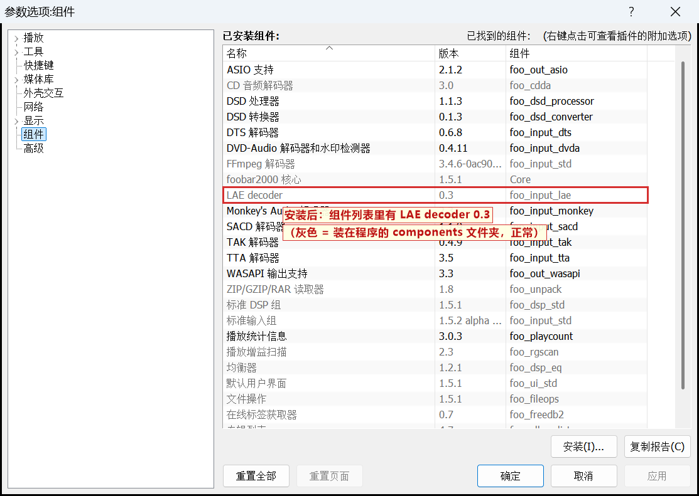
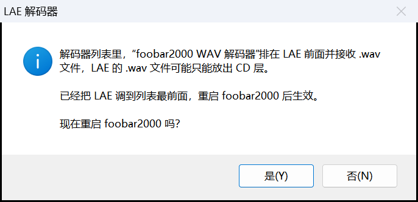
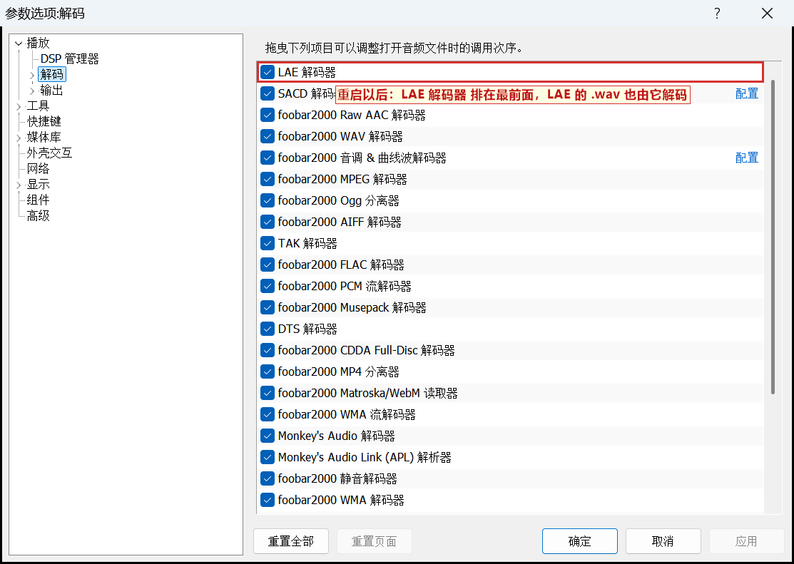
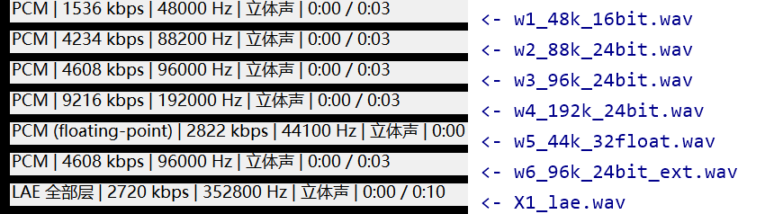
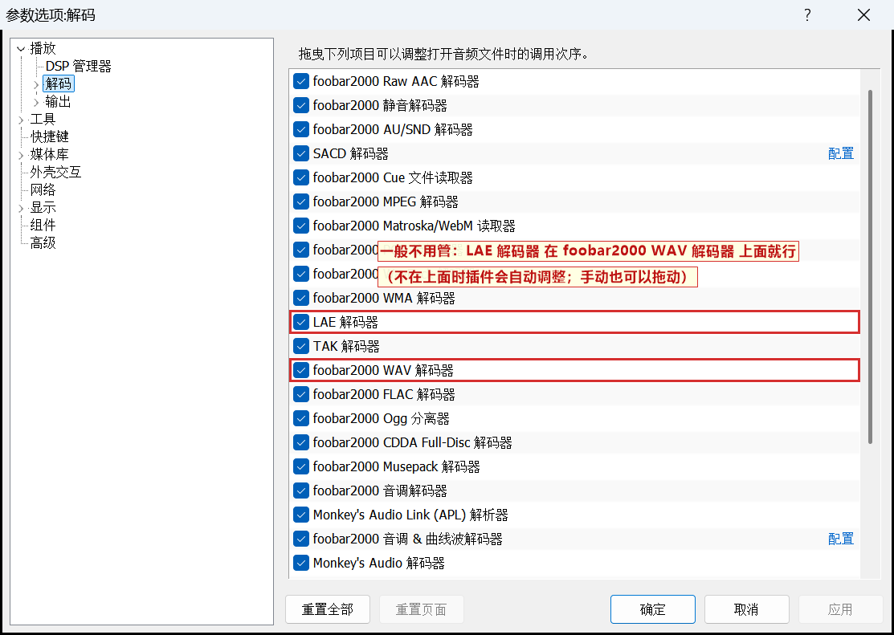
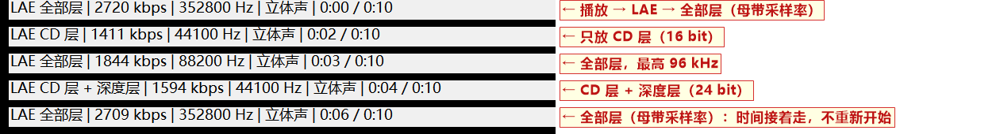
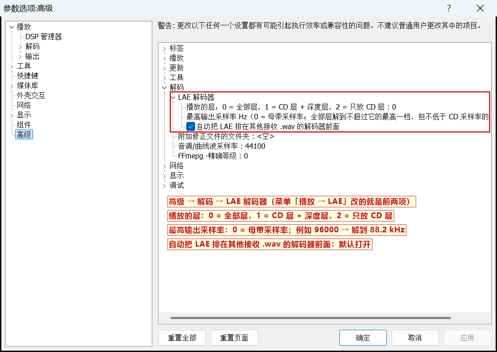
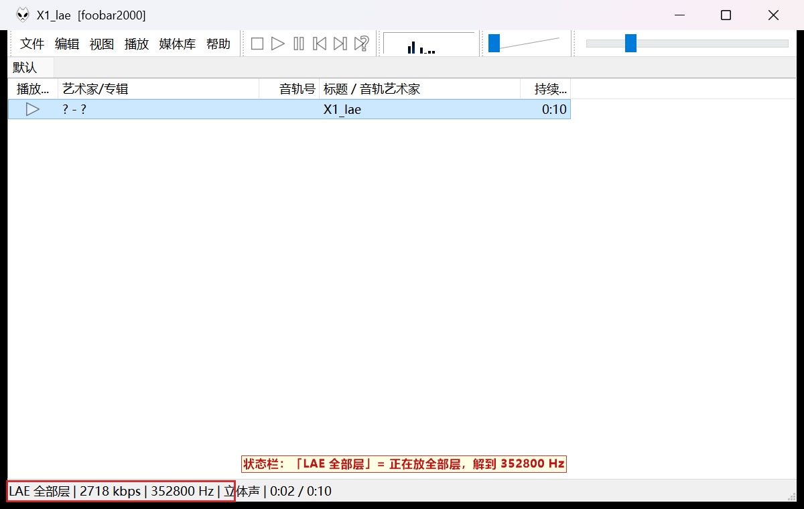
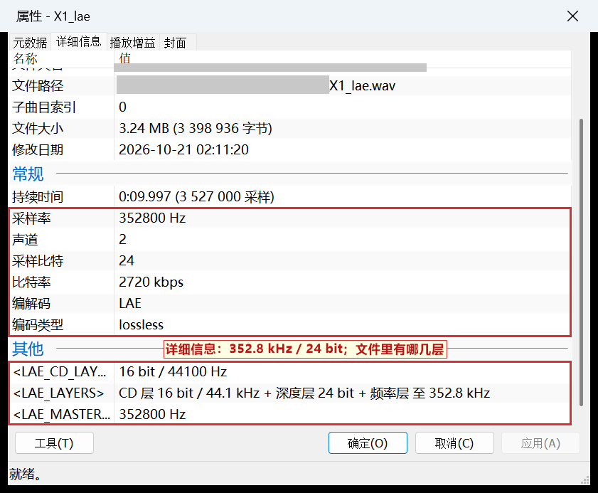
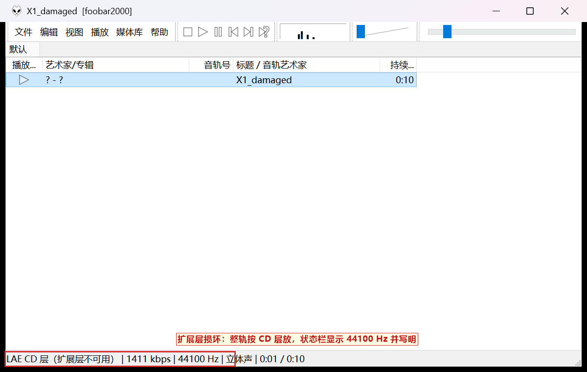

# foo_input_lae —— foobar2000 的 LAE 解码组件

[English](README.md) | **中文**

用 foobar2000 播放两种 LAE 格式：

- **LAEY**（LAE v5，有损扩展，标识 `LAE1`）：CD 层加深度层、频率层，一直解到母带采样率（例如 352.8 kHz / 24 bit）。
- **LAES**（LAE 无损，标识 `LAE2`）：与 核心母带（可以是 CD 兼容的），或其中一个无损母带（16/24/32 bit，44.1/48 kHz × 1、2、4、8），或某个母带的采样率档。母带要先通过 SHA-256 校验，才按母带播放（见 [LAES](#laes无损)）。

没有 LAE 扩展的 WAV、FLAC 立刻拒收，原样交给 foobar2000 自带的解码器。

- 适用：foobar2000 1.4、1.5（含汉化版）、2.x，32 位和 64 位。一个安装包里两种都有，foobar2000 自己挑合适的。
- 文件：LAEY：`.wav`（data 块之后带 `LAE ` 块）和 `.lae`（同一种文件换个扩展名）。LAES：`.wav`（以 `LAE2` 开头的 `LAE ` 块）和 `.flac`（`LAE2` APPLICATION 块）。
- 解码器：本仓库的 liblae（`src/lae_api.*`）和 LAES 解码器（`src/laes_*.h`、`src/laes_api.cpp`），Apache-2.0，编进 DLL 里，不需要别的文件。

截图来自汉化版 foobar2000 1.5.1（干净的便携副本，只放了测试文件）。系统语言是中文时，组件的文字都是中文，否则是英文。

## 安装

推荐：双击 `foo_input_lae-<版本>.fb2k-component`（或「参数选项 → 组件 → 安装…」选这个文件，点应用），让 foobar2000 重启。
foobar2000 自己从包里挑：根目录是 x86 的 DLL，`x64` 文件夹里是 x64 的。

升级时同样安装新包，foobar2000 重启时替换旧版本。之后不要再装旧的包，否则旧版本会把新版本盖掉。

手动（foobar2000 1.x，32 位）：把 `foo_input_lae.dll` 复制到 foobar2000 的 `components` 文件夹，重启即可。
在「参数选项 → 组件」里能看到它（放在程序文件夹里时显示成灰色，这是正常的）。



## 解码顺序：自动，不用拖

LAE 文件可以叫 `.wav`。foobar2000 自带的「foobar2000 WAV 解码器」也接收 `.wav`，两个解码器谁排在前面，`.wav` 就归谁；
WAV 解码器在前面的话，LAE 的 `.wav` 只能放出 CD 层。

- 已经用过一段时间的 foobar2000：新装的解码器 foobar2000 会自动放在列表最前面，什么都不用做。
- 新装的 foobar2000：列表的初始顺序是随机的（实测每个新配置都不一样）。如果 WAV 解码器碰巧排在 LAE 前面，
  插件启动时会自动把自己调到最前面，并提示重启一次 foobar2000：

  
  

  原理：foobar2000 把从没见过的解码器放在最前面，所以插件这时换用第二个身份（GUID）。旧身份在列表最下面留下一行
  「未命名旧解码器」，它不接收任何文件，可以不管：

  

  点「否」也一样，下次启动 foobar2000 时生效。
  插件只在两种情况下调整：第一次看到这份配置的顺序时（foobar2000 随机排的，或者 0.3 以前的顺序），以及以后新装的解码器被
  foobar2000 放在 LAE 前面、又接收 .wav 时（最多三次）。你自己把 LAE 拖到下面去，插件不会再动。不想要自动调整，可以在高级设置里关掉。
- `.lae` 文件只有 LAE 接收，跟顺序无关。
- 普通 WAV 不受影响：LAE 只接收带 LAE 块的文件，其他 .wav（任何采样率、位深）它立刻拒收，交给 foobar2000 自带的 WAV 解码器原样播放。
  下图是 LAE 排在 WAV 解码器前面时，6 种普通 WAV 和 1 个 LAE 文件的状态栏：

  
- 想自己检查：「参数选项 → 播放 → 解码」，LAE 解码器在「foobar2000 WAV 解码器」上面就对了：

  

## 选择播放哪些层：菜单「播放 → LAE」

| 菜单项 | 放出来的是 |
|---|---|
| 全部层（母带采样率） | 全部层，解到母带采样率，例如 352.8 kHz / 24 bit（默认） |
| 全部层，最高 192 kHz | 全部层，解到不超过 192 kHz 的最高一档（352.8k 的母带 → 176.4 kHz） |
| 全部层，最高 96 kHz | 全部层，解到不超过 96 kHz 的最高一档（352.8k 的母带 → 88.2 kHz） |
| CD 层 + 深度层（24 bit） | 44.1 kHz / 24 bit |
| 只放 CD 层（16 bit） | CD 原样，44.1 kHz / 16 bit |

播放中选也立即生效，从当前位置接着放，不从头开始。状态栏第一项写着正在放的层：



同样的设置也在「参数选项 → 高级 → 解码 → LAE 解码器」里，另外还有"自动调整解码顺序"的开关：



## 播放时能看到什么

- 状态栏：`LAE 全部层` / `LAE CD 层 + 深度层` / `LAE CD 层`，后面是解出的采样率。
- 文件属性 → 详细信息：采样率、位深、编解码 LAE；「其他」里有 `lae_layers`（文件里有哪几层）、`lae_master`（母带采样率）、
  `lae_cd_layer`（CD 层规格）。
- 比特率：LAE 是动态码率。CD 层固定（44.1 kHz 家族 1411.2 kbps），扩展层（深度层 + 频率层）是熵编码，内容复杂时多、
  安静时少。播放时状态栏每秒更新一次实际用掉的码率（CD 层 + 这一秒扩展层读掉的字节）；第 1 秒和文件属性里显示的是
  整个文件的平均值（文件大小 ÷ 时长）。只放 CD 层时固定 1411。测试片段的扩展层平均从约 10 kbps 到约 2150 kbps 不等。

  




扩展层损坏时（下面是故意改坏 1 个字节的测试文件），整轨按 CD 层放，状态栏写「LAE CD 层（扩展层不可用）」，控制台写明原因：




## LAEY 的规则（与读取器相同）

- 开播之前核对整个文件（扩展块的 CRC、头和码流结构）；核不过的，整轨按 CD 层放，并在控制台写一句原因；
  状态栏随即改显示实际放出的规格（44.1 kHz / 16 bit），属性里多一项 `lae_route` 写明原因。
- 完整性检查（带 testing-integrity 标志调用解码器的组件）：只能按 CD 层放的文件报为出错。
- 一轨之内不会自动在 CD 层和扩展层之间切换；中途出流错误时报错停下。只有你在菜单里选了别的层，才会在当前位置换过去。
- 解码时钉住浮点状态（舍入到最近、不清零非规格数、x87 53 位精度），用完分别还原 x87 和 SSE 的状态。
- 内存：每一轨只留 CD 层和扩展块，约等于文件大小（0.1 版打开时要 3.6 倍）。32 位的 foobar2000 最多用 4 GB，
  所以一轨一小时以上的 352.8 kHz LAEY 文件要用 64 位的 foobar2000（同一个安装包里的 x64 版）。
- 跳转：往后跳过没放过的部分时，要把熵码流解到目标位置。在测试机（i9-13900HX）上 352.8 kHz 每跳 1 分钟约多花 1.6 秒；
  往回跳、跳到放过的部分都很快。v5 没有跳转表，这是格式本身的限制。

## LAES（无损）

### 放哪一个

这首曲目没有单独选过时，按设置：「只放 CD 层」放核心母带；「CD 层 + 深度层」放基础采样率下最高的一个；否则先取不超过「最高输出采样率」的最高采样率，
再取不超过「LAES：最高位深」的最长字长。母带优先于采样率档；派生 16 位母带（相对其定义无损，相对所取自的母带不是无损）只在别的都不合适时才用。

在曲目上点右键 → **LAES：选择播放内容…**，可以为这首曲目选核心母带、某个母带或某个采样率档。这个选择优先于设置，按路径记住（`laes_choices.txt`），
播放中选也立即生效：新的内容从当前位置开始（约 0.2 秒静音，不会重放已经听过的部分）。选「自动」回到按设置。

### 校验：每个文件一次，记住结果

- 母带要整个解码一遍、样本与文件里存的 SHA-256 一致，才按这个母带播放。在那之前放核心母带，控制台写明原因。
- 第一次校验一遍解完**全部**母带，只有一个进度条（百分比、已用时间、剩余时间）。之后这个文件的任何选择都直接播放。
- 结果按整个文件的 SHA-256 记住（`laes_verified.txt`），不按文件名或日期：文件没变就不再校验，改名、移动也不用；
  改了一个字节就重新校验。没通过的母带一直拒放，核心母带照常能放。
- 此外每次打开都先检查文件本身：全部字节的 SHA-256、扩展的 CRC-32、核心母带。CPU 有 SHA 指令时用指令计算（测试机上约 1.9 GB/s）。
- 提前校验，播放时就不用等：
  - 加入媒体库的文件在后台逐个、低优先级校验（设置，默认开）。
  - 右键 → **校验 LAES（无损）**：立即校验所选文件，带进度条，结果写在控制台。

### 切换和跳转

- 文件里没有索引。解码母带时（以及打开后在后台扫一遍时），播放器记下每个编码块从哪里开始；每 16 个记一个存到配置文件夹（`laes_index`），放过的文件再打开就能直接切换、跳转。音频文件本身从不改动。
  跳转或切换时就从包含该时间的那个块开始解，而不是从头解。
- 开着「让其他母带在后台待命」（设置，默认开）时，一个降低优先级的线程把其他母带在当前位置前后的几秒先解好，切换几乎没有间断。
- 开播前要先解多少，取决于速度：这台电脑上测到的解码速度（播放时或后台校验时）按文件和选择记住（`laes_speed.txt`）。
  电脑够快时，解 0.25 秒就开播；慢的电脑先多解一些，保证中途不停。等待时显示进度条「提前解码，保证播放中途不停顿」。

### 设置（参数选项 → 高级 → 解码 → LAE 解码器）

| 设置 | 默认 |
|---|---|
| LAES（无损）：最高位深（0 = 不限，16、24 或 32） | 0 |
| LAES（无损）：音乐入库时在后台校验（之后播放不用等） | 开 |
| LAES（无损）：播放时让其他母带在后台待命，切换几乎无间断（多用一些 CPU） | 开 |

「播放的层」和「最高输出采样率」对 LAEY、LAES 都适用。

### 文件

所有 LAE 播放器（foobar2000、Kodi、DirectShow）共用当前用户的 `%APPDATA%\LAE`（0.15 起；0.14 及以前在 foobar2000 配置文件夹，仍会读取）：
一个文件在任一播放器里校验过，在其他播放器里也直接播放。

| 文件 | 内容 |
|---|---|
| `laes_verified.txt` | 每个文件的 SHA-256 和母带：`ok` 或 `fail`（只追加，同时运行的播放器互不覆盖）；另有提示行 `file <大小> <路径> ok`，让已知文件不显示为"待校验" |
| `laes_index\<SHA-256>.idx` | 每个文件一份：每层每 16 块记一个起点（10 分钟、4 个母带的文件约 18 kB），带文件的 SHA-256 和 CRC-32；放过的文件再打开就能直接切换、跳转，不用再在后台扫一遍。从不写进音频文件；对不上的记录不用 |

foobar2000 配置文件夹里（本播放器自己的）：

| 文件 | 内容 |
|---|---|
| `laes_choices.txt` | 每首曲目的选择：`<选择名>` TAB `<路径>`（0.10 及以前误写在配置文件夹旁边；0.11 会从那里读一次） |
| `laes_speed.txt` | 每个文件的 SHA-256 和选择（或 `all`）：解码速度，是实时的多少倍 |
| `laes_debug.log` | 只有你自己建了这个（空）文件才写：LAES 播放的事件记录（打开、跳转、切换、关闭），用来报告播放问题；删掉就不再记录 |

文本文件都是纯文本；删掉哪个，只是文件要重新校验、重新选或重新测速。解出的音频放在临时文件里，关闭时由 Windows 删除。

### 内存和速度

- 解出的内容放在临时文件里，不放内存，所以 32 位的 foobar2000 也能放很长的高解析母带。
- 解码器用全部 CPU 核（后台校验用一半）。x64 版比 x86 版快（寄存器多，有 64 位乘法）；测试机（i9-13900HX）上一个测试文件（937 MB，FLAC）的文件检查，
  x86 用 2.0 秒，x64 用 1.4 秒；FLAC 核心母带分成几段同时解码。
- 所有加速路径的输出逐位相同，都和参考解码器对过（`tests/laes`）。

## 已知问题：ESLyric 0.3.6 闪退

汉化版附带的歌词插件 ESLyric 0.3.6（2017 年）在换曲、停止或关闭 foobar2000 时，如果网上歌词还在下载，会在
`foo_uie_eslyric.dll` 里访问已释放的内存而闪退（`crash reports\failure_*.txt` 里写着 `eslyric_manager::_release_all`）。
与 LAE 无关：不装本组件、只放普通 WAV 也会出现；去掉 ESLyric 就不再出现。10–15 秒的短测试文件最容易碰上。
解决：换用更新的 ESLyric 版本，或者暂时移除它（参数选项 → 组件，在 ESLyric 上点右键移除，重启 foobar2000）。

## 编译

需要两个 foobar2000 SDK（不放进本仓库）：

- x86：`SDK-2019-12-27.7z`（576,451 字节，SHA-256 `c9fe776096bcf2c5ec6f07788b4036c9146dd857bf3232053c13c1ee317e5ff6`，来自 https://www.foobar2000.org/downloads/SDK-2019-12-27.7z），
  保证组件在 foobar2000 1.4 / 1.5 里也能加载。
- x64：`SDK-2026-10-01.7z`（793,738 字节，SHA-256 `d4c55077336fae81bf8df0259b5b2748fa45ea84132c656ead93eb123cbcdc26`，来自 https://www.foobar2000.org/SDK）。

```bat
plugins\foo_input_lae\build_fb2k.cmd <SDK-2019-12-27 文件夹> <SDK-2026-10-01 文件夹> <输出文件夹>
```

用 VS2022 生成工具（x86 和 x64 编译器）。脚本编两个 DLL，打包成 `foo_input_lae.fb2k-component`（x86 在根目录，x64 在 `x64\`）。
旧 SDK 的代码按它的说明加 `/d2notypeopt`；x64 组件按新 SDK 的要求用 C++20 和 `/permissive`。
解码器用各自验证过的选项：liblae `/fp:precise`，LAES 解码器 `/fp:strict`（参考抽头用 double 计算）。

## 许可

- 本组件的源码：Apache-2.0。
- 编进 DLL 的 foobar2000 SDK（x86：2019-12-27，x64：2026-10-01）：Copyright (c) Peter Pawlowski，BSD 式许可（`sdk-license.txt`；分发源码须保留版权声明，
  不得用作者的名义背书）；pfc：zlib 许可。
