# foo_input_lae —— foobar2000 的 LAE 解码组件

[English](README.md) | **中文**

用 foobar2000 播放 LAE v5 文件：CD 层加深度层、频率层，一直解到母带采样率（例如 352.8 kHz / 24 bit）。
没有 LAE 扩展的 WAV 原样交给 foobar2000 自带的解码器。

- 适用：foobar2000 1.4、1.5（含汉化版）、2.x 的 32 位版本。2.x 的 64 位版本以后用新 SDK 另编一份。
- 文件：`.wav`（data 块之后带 `LAE ` 块）和 `.lae`（同一种文件换个扩展名）。
- 解码器：liblae（本仓库 `src/lae_api.*`，Apache-2.0），编进这个 DLL 里，不需要别的文件。

截图来自汉化版 foobar2000 1.5.1（干净的便携副本，只放了测试文件）。系统语言是中文时，组件的文字都是中文，否则是英文。

## 安装

把 `foo_input_lae.dll` 复制到 foobar2000 的 `components` 文件夹，重新启动 foobar2000，就可以放了。
在「参数选项 → 组件」里能看到它（显示成灰色是正常的：放在程序文件夹里的组件都这样）。

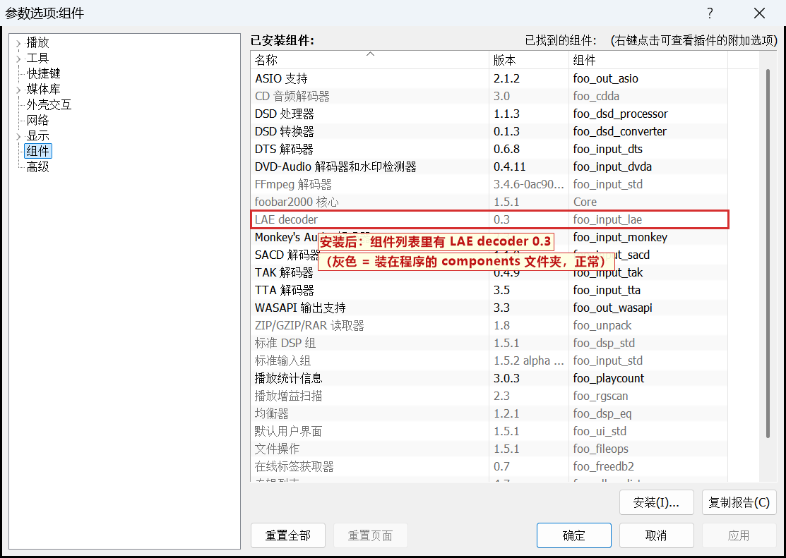

## 解码顺序：自动，不用拖

LAE 文件可以叫 `.wav`。foobar2000 自带的「foobar2000 WAV 解码器」也接收 `.wav`，两个解码器谁排在前面，`.wav` 就归谁；
WAV 解码器在前面的话，LAE 的 `.wav` 只能放出 CD 层。

- 已经用过一段时间的 foobar2000：新装的解码器 foobar2000 会自动放在列表最前面，什么都不用做。
- 新装的 foobar2000：列表的初始顺序是随机的（实测每个新配置都不一样）。如果 WAV 解码器碰巧排在 LAE 前面，
  插件启动时会自动把自己调到最前面，并提示重启一次 foobar2000：

  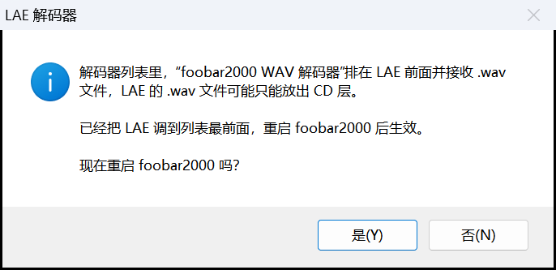
  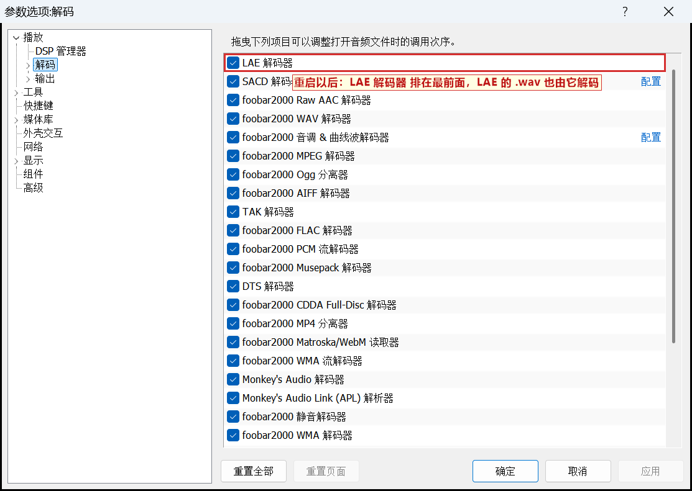

  原理：foobar2000 把从没见过的解码器放在最前面，所以插件这时换用第二个身份（GUID）。旧身份在列表最下面留下一行
  「未命名旧解码器」，它不接收任何文件，可以不管：

  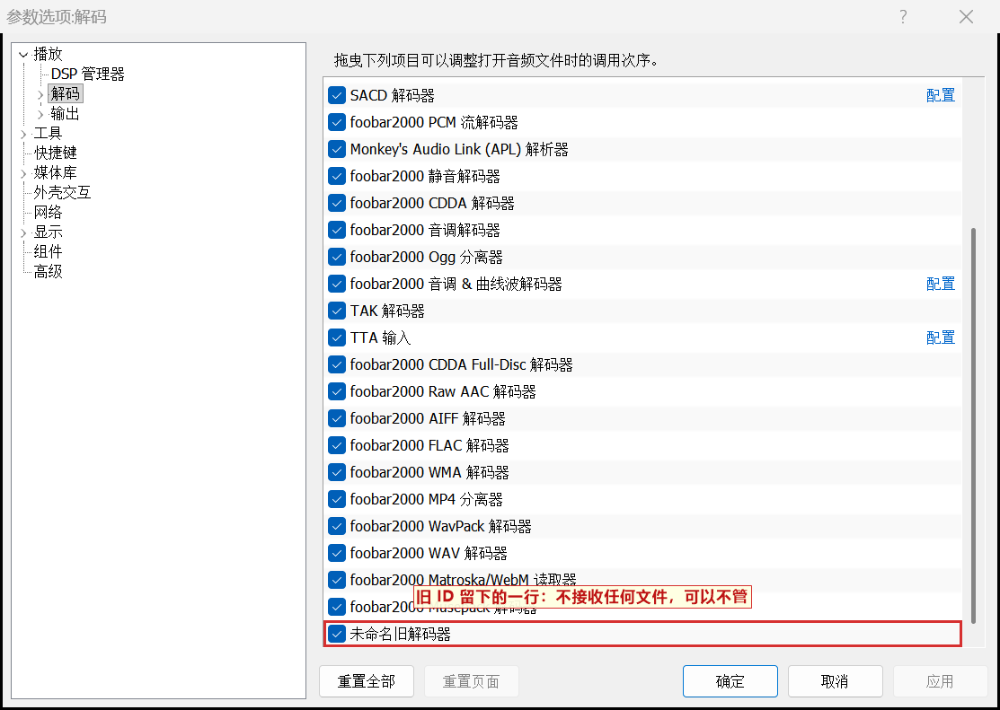

  点「否」也一样，下次启动 foobar2000 时生效。
  插件只在两种情况下调整：第一次看到这份配置的顺序时（foobar2000 随机排的，或者 0.3 以前的顺序），以及以后新装的解码器被
  foobar2000 放在 LAE 前面、又接收 .wav 时（最多三次）。你自己把 LAE 拖到下面去，插件不会再动。不想要自动调整，可以在高级设置里关掉。
- `.lae` 文件只有 LAE 接收，跟顺序无关。
- 普通 WAV 不受影响：LAE 只接收带 LAE 块的文件，其他 .wav（任何采样率、位深）它立刻拒收，交给 foobar2000 自带的 WAV 解码器原样播放。
  下图是 LAE 排在 WAV 解码器前面时，6 种普通 WAV 和 1 个 LAE 文件的状态栏：

  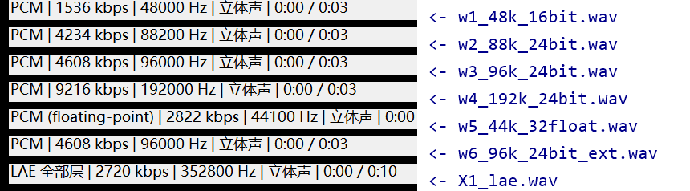
- 想自己检查：「参数选项 → 播放 → 解码」，LAE 解码器在「foobar2000 WAV 解码器」上面就对了：

  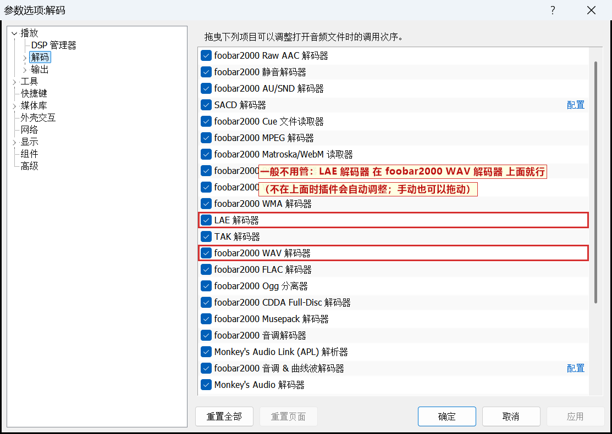

## 选择播放哪些层：菜单「播放 → LAE」

| 菜单项 | 放出来的是 |
|---|---|
| 全部层（母带采样率） | 全部层，解到母带采样率，例如 352.8 kHz / 24 bit（默认） |
| 全部层，最高 192 kHz | 全部层，解到不超过 192 kHz 的最高一档（352.8k 的母带 → 176.4 kHz） |
| 全部层，最高 96 kHz | 全部层，解到不超过 96 kHz 的最高一档（352.8k 的母带 → 88.2 kHz） |
| CD 层 + 深度层（24 bit） | 44.1 kHz / 24 bit |
| 只放 CD 层（16 bit） | CD 原样，44.1 kHz / 16 bit |

播放中选也立即生效，从当前位置接着放，不从头开始。状态栏第一项写着正在放的层：

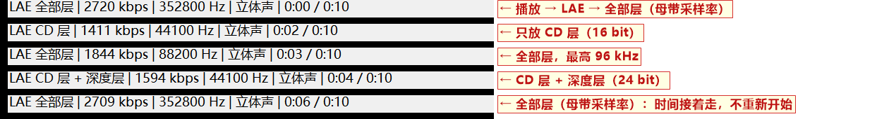

同样的设置也在「参数选项 → 高级 → 解码 → LAE 解码器」里，另外还有"自动调整解码顺序"的开关：

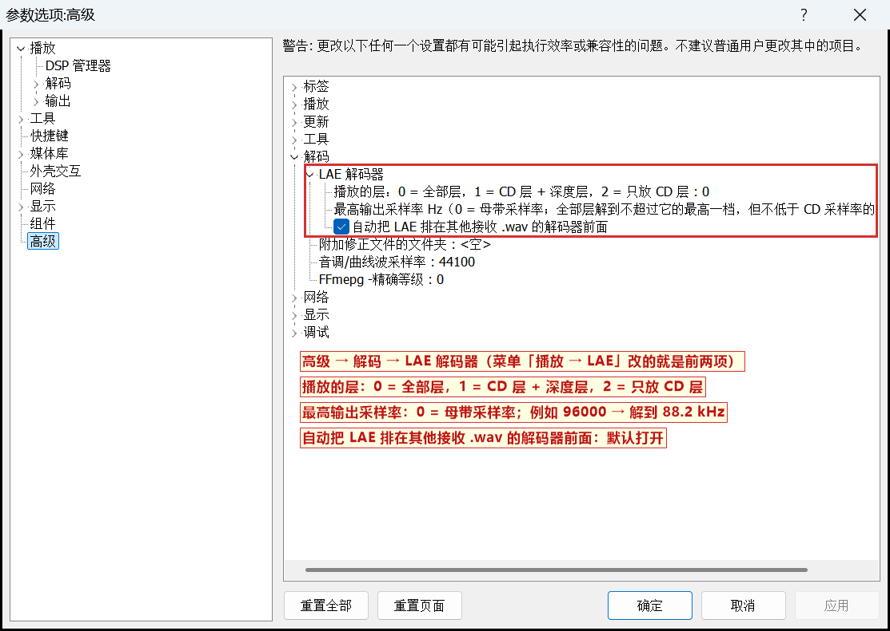

## 播放时能看到什么

- 状态栏：`LAE 全部层` / `LAE CD 层 + 深度层` / `LAE CD 层`，后面是解出的采样率。
- 文件属性 → 详细信息：采样率、位深、编解码 LAE；「其他」里有 `lae_layers`（文件里有哪几层）、`lae_master`（母带采样率）、
  `lae_cd_layer`（CD 层规格）。
- 比特率：LAE 是动态码率。CD 层固定（44.1 kHz 家族 1411.2 kbps），扩展层（深度层 + 频率层）是熵编码，内容复杂时多、
  安静时少。播放时状态栏每秒更新一次实际用掉的码率（CD 层 + 这一秒扩展层读掉的字节）；第 1 秒和文件属性里显示的是
  整个文件的平均值（文件大小 ÷ 时长）。只放 CD 层时固定 1411。测试片段的扩展层平均从约 10 kbps 到约 2150 kbps 不等。

  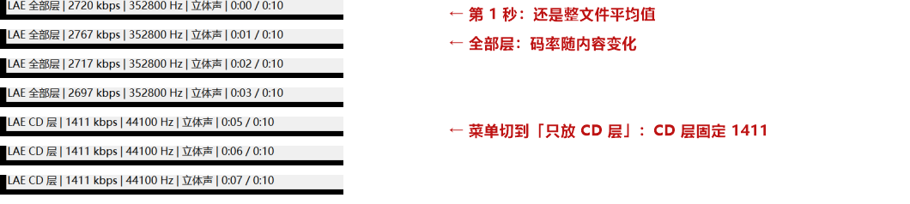

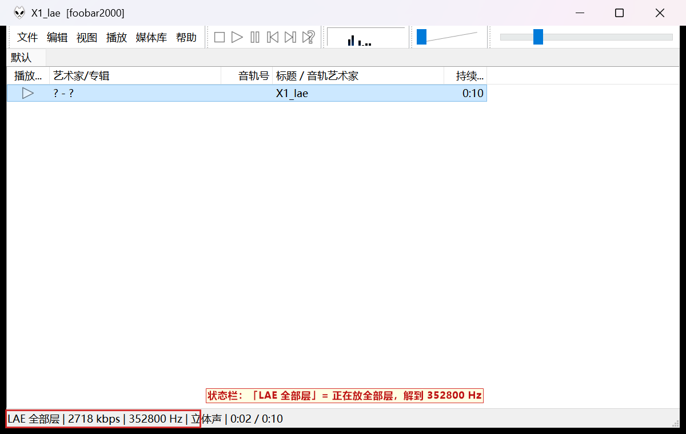
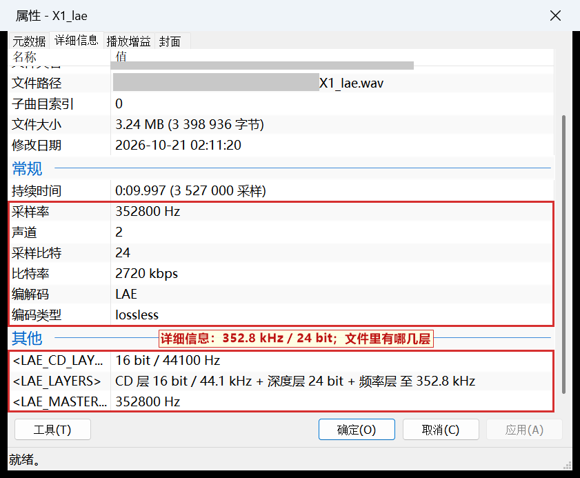

扩展层损坏时（下面是故意改坏 1 个字节的测试文件），整轨按 CD 层放，状态栏写「LAE CD 层（扩展层不可用）」，控制台写明原因：

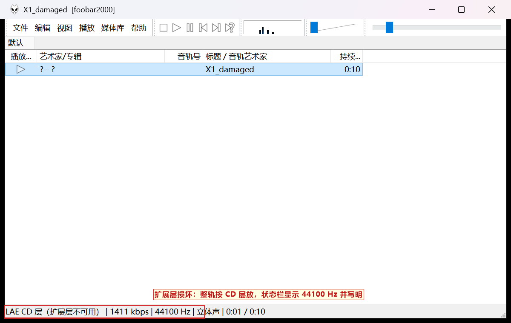
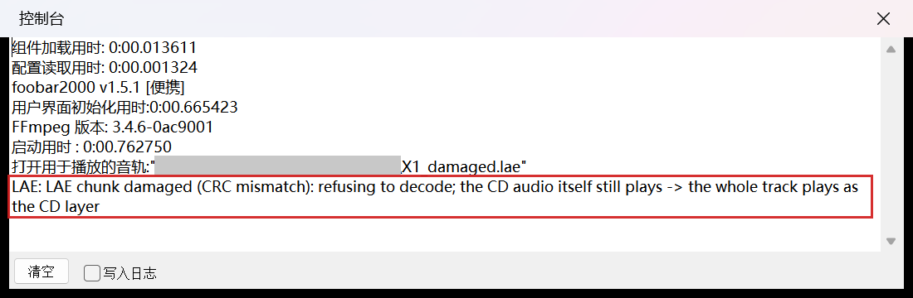

## 规则（与读取器相同）

- 开播之前核对整个文件（扩展块的 CRC、头和码流结构）；核不过的，整轨按 CD 层放，并在控制台写一句原因；
  状态栏随即改显示实际放出的规格（44.1 kHz / 16 bit），属性里多一项 `lae_route` 写明原因。
- 完整性检查（带 testing-integrity 标志调用解码器的组件）：只能按 CD 层放的文件报为出错。
- 一轨之内不会自动在 CD 层和扩展层之间切换；中途出流错误时报错停下。只有你在菜单里选了别的层，才会在当前位置换过去。
- 解码时钉住浮点状态（舍入到最近、不清零非规格数、x87 53 位精度），用完分别还原 x87 和 SSE 的状态。
- 内存：每一轨只留 CD 层和扩展块，约等于文件大小（0.1 版打开时要 3.6 倍）。32 位的 foobar2000 最多用 4 GB，
  所以一轨一小时以上的 352.8 kHz 文件要等 64 位版本。
- 跳转：往后跳过没放过的部分时，要把熵码流解到目标位置。在测试机（i9-13900HX）上 352.8 kHz 每跳 1 分钟约多花 1.6 秒；
  往回跳、跳到放过的部分都很快。v5 没有跳转表，这是格式本身的限制。

## 已知问题：ESLyric 0.3.6 闪退

汉化版附带的歌词插件 ESLyric 0.3.6（2017 年）在换曲、停止或关闭 foobar2000 时，如果网上歌词还在下载，会在
`foo_uie_eslyric.dll` 里访问已释放的内存而闪退（`crash reports\failure_*.txt` 里写着 `eslyric_manager::_release_all`）。
与 LAE 无关：不装本组件、只放普通 WAV 也会出现；去掉 ESLyric 就不再出现。10–15 秒的短测试文件最容易碰上。
解决：换用更新的 ESLyric 版本，或者暂时移除它（参数选项 → 组件，在 ESLyric 上点右键移除，重启 foobar2000）。

## 编译

需要 foobar2000 1.5 SDK：`SDK-2019-12-27.7z`（576,451 字节，SHA-256 `c9fe776096bcf2c5ec6f07788b4036c9146dd857bf3232053c13c1ee317e5ff6`，
来自 https://www.foobar2000.org/downloads/SDK-2019-12-27.7z）。SDK 不放进本仓库。

```bat
plugins\foo_input_lae\build_fb2k.cmd <解开的 SDK 文件夹> <输出文件夹>
```

用 VS2022 生成工具的 x86 编译器；SDK 代码按 SDK 说明加 `/d2notypeopt`，LAE 解码器用它自己验证过的选项（`/fp:precise`）。

## 许可

- 本组件的源码：Apache-2.0。
- 编进 DLL 的 foobar2000 SDK：Copyright (c) 2001-2019 Peter Pawlowski，BSD 式许可（`sdk-license.txt`；分发源码须保留版权声明，
  不得用作者的名义背书）；pfc：zlib 许可。
