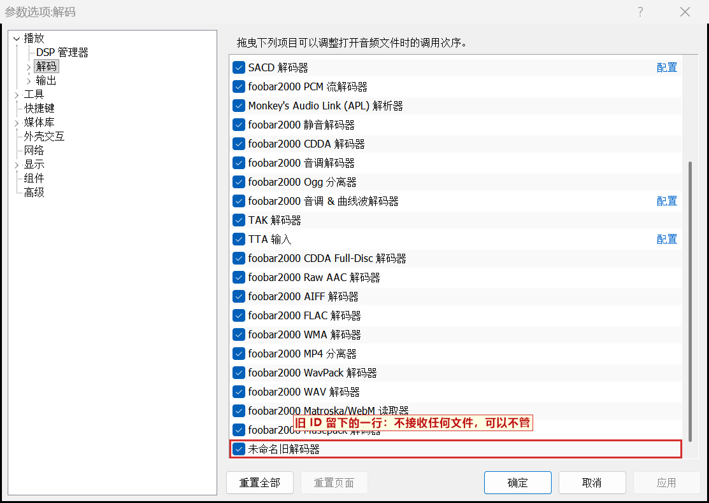
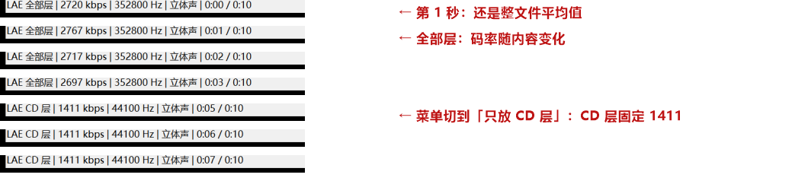
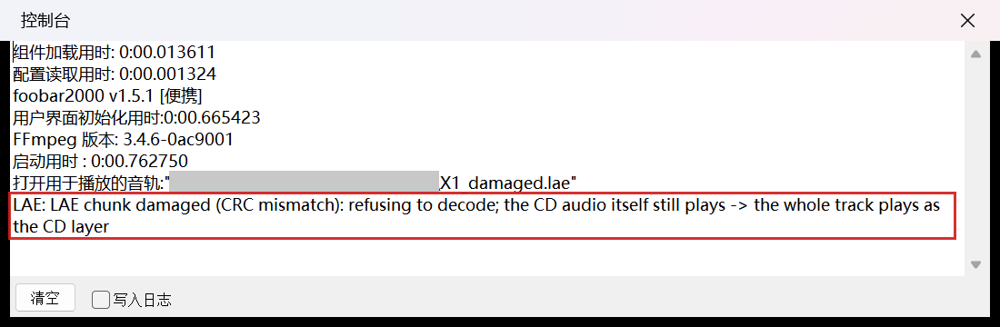

# foo_input_lae：foobar2000 的 LAE 解码组件

[English](README.md) | **中文**（以英文版为准）

本组件用于在 foobar2000 中播放两种 LAE 格式：

- **LAE Lossy (LAEY)**（LAE 容器版本 5，有损扩展，标识 `LAE1`）：CD 层连同位深层和频率层，解码至母带采样率（例如 352.8 kHz / 24 bit）。
- **LAE Lossless (LAES)**（标识 `LAE2`）：核心母带（可以是 CD 兼容的）、其中一个无损母带（16/24/32 bit，44.1/48 kHz × 1、2、4 或 8），或某一母带的一个采样率档位。母带只有在其 SHA-256 校验通过后才按该母带播放（见 [LAES](#laes-lossless)）。

不带 LAE 扩展的 WAV 或 FLAC 文件会被立即拒收，并原样交由 foobar2000 自带的解码器处理。

- 宿主：foobar2000 1.4、1.5（含汉化版）和 2.x，32 位和 64 位。一个安装包同时包含两种构建，由 foobar2000 选择与之匹配的一种。
- 文件：LAEY：`.wav`（在 `data` 块之后带有 `LAE ` 块）、`.flac`（FLAC 形式，带有 `LAE1` APPLICATION 块）和 `.lae`（两种形式之一，扩展名不同）。LAES：`.wav`（带有以 `LAE2` 开头的 `LAE ` 块）和 `.flac`（带有 `LAE2` APPLICATION 块）。
- 解码器：本仓库的 liblae（`src/lae_api.*`）和 LAES 解码器（`src/laes_*.h`、`src/laes_api.cpp`）（Apache-2.0），已编译进 DLL。不需要其他文件。

截图摄于汉化版 foobar2000 1.5.1（干净的便携式安装，仅含测试文件）。组件分英文（`-en`）和中文（`-zh`）两个独立版本，各自的全部文字都用本版本的语言，与系统语言无关。下文依据英文界面文字。

## 本次更新的变化

- **FLAC 形式的 LAEY**（`.flac`，或装着 FLAC 形式的 `.lae`；[spec/lossy/SPEC.md](../../spec/lossy/SPEC.zh.md) 第 3.4 节）。文件按内容识别，从不按文件名识别。
- **LAEY 扩展包**（同一规范第 5.6 节）。右键菜单"LAEY：选择层…"按文件中存储的名称列出各扩展包（没有名称时为"扩展包 {n}"，和母带一样从 1 数起："扩展包 n" 是母带 n 的扩展包，`lae_dec pack=`、DirectShow 和 VLC 从 0 数起，记作 n − 1），并显示各自的母带采样率；扩展包之内是"全部层""仅频率层""仅位深层"，各带采样率和位深；"仅 CD 层/核心层"留在第一层。不含位深层的档位标为 16 位。选择由 foobar2000 按文件保存，从不写入文件；不会自动选择任何扩展包。
- **LAES 有效载荷版本 2**（[spec/lossless/SPEC.md](../../spec/lossless/SPEC.zh.md) 第 6.2 和 10.3 节）：文件中存储的母带名称、菜单顺序和默认母带。"LAES：选择母带…"第一层列出核心母带和各母带（编号、名称、采样率、位深、时长、"无损"，默认项加标记）；母带的采样率级别和派生 16 位版本放在该母带自己的子菜单里（"由母带 {n}「{name}」派生 · {rate} / {bits}"）。没有选择时播放文件的默认母带；文件没有默认母带时播放核心母带。
- 母带及其参照链上的每个母带的 SHA-256 全部相符后，才播放该母带；核对结果按文件内容保存。未通过的母带留在菜单中，标为"（不可用：SHA-256 不符）"。
- 派生 16 位版本从跳转位置开始播放，与从头解码逐位相同。

## 安装

推荐方式：双击 `foo_input_lae-<version>.fb2k-component`（或打开「参数选项 → 组件 → 安装…」，选择该文件并点击「应用」），并允许 foobar2000 重启。
foobar2000 从安装包中选取与之匹配的 DLL：根目录中的 x86 DLL 或 `x64` 文件夹中的 x64 DLL。

升级时，以同样方式安装新的安装包；foobar2000 在重启时替换旧版本。此后不要再安装较旧的安装包，否则它会替换较新的版本。

手动安装（foobar2000 1.x，32 位）：将 `foo_input_lae.dll` 复制到 foobar2000 的 `components` 文件夹，然后重启 foobar2000。
本组件列于「参数选项 → 组件」中（当它位于 foobar2000 程序文件夹的 `components` 文件夹而非用户配置文件夹中时显示为灰色；这是正常的）。


## 解码器顺序：自动调整，无需拖动

LAE 文件的扩展名可以是 `.wav`。内置的「foobar2000 WAV 解码器」也接收 `.wav` 文件，这两个解码器中在列表里排在前面的一个将接收这些文件。
若 WAV 解码器排在前面，LAE `.wav` 文件只播放其 CD 层。

- 已使用一段时间的 foobar2000 安装：foobar2000 会自动将新安装的解码器置于列表顶部，无需任何操作。
- 新的 foobar2000 安装：列表的初始顺序是随机的（测试中，每个新配置的顺序均不相同）。若 WAV 解码器恰好排在 LAE 之前，
  本组件会在启动时将自身移至顶部，并要求重启一次 foobar2000：

  
  

  工作原理：foobar2000 将从未见过的解码器置于顶部，因此本组件此时改用其第二个身份（GUID）。旧身份会在列表底部留下一行，
  在汉化版中显示为「未命名旧解码器」。该行不接收任何文件，可以忽略：

  

  回答「否」效果相同；此时更改在下次启动 foobar2000 时生效。
  本组件仅在两种情况下调整顺序：首次遇到某一配置的顺序时（由 foobar2000 随机设定，或来自早于 0.3 的版本的顺序），以及此后当 foobar2000
  将一个同样接收 .wav 文件的新安装解码器置于 LAE 之前时（最多三次）。若用户自行将 LAE 拖到更下方，本组件不会再移动它。自动调整可在高级设置中关闭。
- `.lae` 文件仅由 LAE 接收，与顺序无关。
- 普通 WAV 文件不受影响：LAE 仅接收带有 LAE 块的文件。对于其他所有 .wav 文件（任何采样率和位深），它立即拒收，由 foobar2000 内置的 WAV 解码器原样播放。
  截图显示 LAE 排在 WAV 解码器之前时，六个普通 WAV 文件和一个 LAE 文件的状态栏：

  
- 如需自行检查顺序，打开「参数选项 → 播放 → 解码」。当「LAE 解码器」位于「foobar2000 WAV 解码器」之上时，顺序正确：

  

## 选择层：菜单「播放 → LAE」

| 菜单项 | 播放内容 |
|---|---|
| 全部层 · 母带采样率 | 全部层，解码至母带采样率，例如 352.8 kHz / 24 位（默认）。 |
| 全部层 · 最高 176.4 / 192 kHz | 全部层，解码至不高于 192 kHz 的最高采样率档（352.8 kHz 母带 → 176.4 kHz）。 |
| 全部层 · 最高 88.2 / 96 kHz | 全部层，解码至不高于 96 kHz 的最高采样率档（352.8 kHz 母带 → 88.2 kHz）。 |
| 仅频率层 · 母带采样率（以及同样的两档上限） | CD 层/核心层加频率层，不含位深层：16 位精度，以 24 位字长输出。 |
| 仅位深层 · 24 位 | 基础采样率下的 CD 层/核心层加位深层，例如 44.1 kHz / 24 位。 |
| 仅 CD 层/核心层 · 16 位 | 原样的 CD 层/核心层，例如 44.1 kHz / 16 位。 |

「最高采样率，Hz」（高级设置）低于基础采样率的 2 倍时（例如 44.1 kHz 的文件设为 48000），没有高于基础采样率的采样率可用：「全部层」改为播放位深层（基础采样率下 24 位），「仅频率层」改为播放 CD 层/核心层（16 位），与 DirectShow 和 VLC 插件相同；状态栏另外标出「最高采样率」和所设的上限。

播放过程中所作的选择立即生效，并从当前位置继续播放；曲目不会从头开始。状态栏的第一个字段给出正在播放的层：


相同的设置也位于「参数选项 → 高级 → 解码 → LAE 解码器」中，另有选项「LAE 优先于其他 .wav / .flac 解码器」：


## 播放时显示的内容

- 状态栏（LAEY）：`LAEY · 全部层` / `LAEY · 仅位深层` / `LAEY · 仅频率层` / `LAEY · 仅 CD 层`（48 kHz 系列为 `核心层`）；文件带扩展包时，中间还有扩展包（`LAEY · <扩展包名称> · 全部层`），其后为解码出的采样率。
- 文件属性 → 详细信息：采样率、位深和编解码器（LAE）；「其他」下有：`lae_layers`（文件所含的层）、`lae_master`（母带采样率）和
  `lae_cd_layer`（CD 层的格式）。
- 比特率：LAE 采用可变比特率。CD 层是固定的（44.1 kHz 系列为 1411.2 kbps）；扩展层（位深层和频率层）经熵编码，内容复杂时需要更多数据，
  内容安静时需要较少数据。播放过程中，状态栏显示实际使用的比特率，每秒更新一次（CD 层加上该秒内读取的扩展字节）；在第一秒内以及在文件属性中，
  显示整个文件的平均值（文件大小 ÷ 时长）。仅播放 CD 层时，比特率固定为 1411 kbps（1411.2 kbps，显示时取整）。对于各测试片段，扩展层的平均比特率在约 10 kbps 至约 2150 kbps 之间。

  


扩展损坏时（下图为故意改动了一个字节的测试文件），整个曲目按 CD 层播放，状态栏显示「LAEY · 仅 CD 层 · 扩展层不可用」，控制台给出原因：




## LAEY 规则（与解码器 `lae_dec` 相同）

- 播放前检查整个文件（扩展块的 CRC 以及头部和码流的结构）。未通过检查的文件整体按 CD 层播放，并在控制台中以一行文字给出原因；
  此时状态栏显示实际播放的格式（44.1 kHz / 16 bit），属性中增加一项 `lae_route`，其中包含原因。
- 完整性检查（以 testing-integrity 标志调用解码器的组件）：只能按 CD 层播放的文件报告为错误。
- 在一个曲目内，本组件从不自行在 CD 层与扩展之间切换；播放过程中的码流错误报告为错误并停止播放。只有在菜单中作出不同的选择，才会在当前位置更换层。
- 解码期间，浮点状态被固定（舍入到最近，非规格化数不清零，x87 为 53 位精度）；之后分别恢复 x87 和 SSE 的状态。
- 内存：对每个曲目，仅保留 CD 层和扩展块，约与文件大小相当（0.1 版在打开文件时需要 3.6 倍于此的内存）。32 位的 foobar2000（1.5.1）启用了大地址感知：在 64 位 Windows 上最多可使用 4 GB，在 32 位 Windows 上为 2 GB，
  因此时长超过约一小时的 352.8 kHz LAEY 曲目需要 64 位的 foobar2000（同一安装包中的 x64 构建）。
- 跳转：向前跳转至尚未播放的部分时，必须熵解码至目标位置。在测试机（i9-13900HX）上，352.8 kHz 时每跳过一分钟约需 1.6 s；
  向后跳转或跳转至已播放的部分则很快。容器版本 5 没有跳转表；这是格式本身的限制。

## LAES（无损）

### 播放内容

若未对该曲目作出选择，播放文件的默认母带（出版方编码时标出的母带；没有标出，或载荷未通过检查时，播放核心母带，核心母带仅当其为 44.1 kHz、16 bit 时才可以是 CD 兼容的）。不按采样率或位深自动选择母带（[spec/lossless/SPEC.md](../../spec/lossless/SPEC.md) 第 10.3 节）。
设置只在这个母带之内起作用：「仅 CD 层/核心层」改为播放核心母带；「仅位深层」播放默认母带在基础采样率下的档位；否则播放它不高于「最高采样率，Hz」的最高采样率档位。字长超过「LAES 最高位深」时，播放该条目自己的派生 16 位版本（相对于其定义无损，而非相对于其来源母带无损）。默认母带没有合适的档位时，播放核心母带。

在曲目上点击右键并选择 **LAES：选择母带…**，可为该曲目选择核心母带、某一母带或某一采样率档位。该选择优先于设置，按路径保存（`laes_choices.txt`），
并在播放过程中立即生效：新的选择从当前位置开始（当其他母带未保持就绪时，会有约 0.2 s 的短暂静音，见[切换与跳转](#切换与跳转)；不会重复已听过的部分）。「自动」恢复为按设置播放。

### 校验：每个文件一次，结果保存

- 母带只有在被完整解码且其样本与文件中存储的 SHA-256 一致之后，才按该母带播放。在此之前播放核心母带，控制台给出原因。
- 首次校验在一遍中解码**全部**母带，只显示一个进度条（百分比、已用时间、剩余时间）。此后，该文件的任何选择均立即播放。
- 结果按整个文件的 SHA-256 保存（`laes_verified.txt`），而非按其名称或日期：未改变的文件不会再次校验，即使已被重命名或移动；
  改动了一个字节的文件会被再次校验。未通过校验的母带始终被拒绝；核心母带仍可播放。
- 在此之前，每次打开文件时都会检查文件本身：全部字节的 SHA-256、扩展的 CRC-32 以及核心母带。SHA-256 计算在可用时使用 CPU 的 SHA 指令（测试机上约 1.9 GB/s）。
- 在播放前校验：
  - 加入媒体库的文件在后台以低优先级逐个校验（一项设置，默认开启）。
  - 右键 → **LAES：校验母带** 立即校验所选文件，并显示进度条；结果显示在控制台中。

### 切换与跳转

- 文件不含索引。在解码母带期间（以及文件打开后在后台进行一次），播放器记录每个编码块的起始位置。这些位置中每第 16 个存储于配置文件夹（`laes_index`），使得此前见过的文件能够立即切换和跳转；媒体文件从不被修改。
  此后，跳转或切换从包含目标时间的块开始，而不是从头解码。
- 在启用「让其他母带保持就绪」（一项设置，默认开启）时，一个降低了优先级的线程在当前播放位置前后保持其他母带若干秒的已解码内容，使切换几乎无间断。只要内存允许，每个通过校验的其他母带都保持就绪：开始前，组件估算每个母带所需的内存（解码器在 352.8 kHz 时约 30 MB，加上保留的样本），只准备 1 GB 以上空闲内存的一半所能容纳的数量，按菜单顺序先准备与正在播放的母带相邻的；播放中空闲内存低于 768 MB 时，放弃最远的一个。准备的数量少于全部时，状态栏和控制台会说明（「内存不足：其他母带只准备了 2 / 11 个」）；切换到没有准备的母带时可能短暂停顿。
- 播放开始前解码多少取决于速度：在本计算机上测得的解码速度（在播放期间或后台校验期间）按文件和选择存储
  （`laes_speed.txt`）。在足够快的计算机上，四分之一秒后即开始播放；在较慢的计算机上，会预先解码足够的内容，使播放在中途不会停止。
  进度条「提前解码，以免播放暂停」表示此等待。

### 设置（参数选项 → 高级 → 解码 → LAE 解码器）

| 设置 | 默认值 |
|---|---|
| LAES 最高位深（0 = 不限，16、24、32） | 0 |
| LAES（无损）：音乐入库时在后台校验（之后播放不用等） | 开 |
| LAES（无损）：播放时让其他母带在后台待命，切换几乎无间断（多用一些 CPU） | 开 |

「LAEY 层」和「最高采样率，Hz」对 LAEY 和 LAES 均适用（见[播放内容](#播放内容)）。

### 文件

以下文件由当前用户的所有 LAE 播放器（foobar2000、Kodi、DirectShow）共用，存储于 `%APPDATA%\LAE`（自 0.15 起；0.14 及以前存储于 foobar2000
配置文件夹，该处仍会被读取）。因此，在一个播放器中校验过的文件在其他播放器中也会立即播放。

| 文件 | 内容 |
|---|---|
| `laes_verified.txt` | 每个文件的 SHA-256 和母带：`ok` 或 `fail`（各行只追加，使同时运行的播放器保留彼此的结果）；以及提示行 `file <size> <path> ok`，使已知文件不显示为「待校验」。 |
| `laes_index\<SHA-256>.idx` | 每个文件一份：每一层每第 16 个块的起始位置（10 分钟、含 4 个母带的文件约 18 kB），附有文件的 SHA-256 和一个 CRC-32；此前见过的文件无需后台扫描即可立即切换和跳转。从不写入媒体文件；不匹配的记录被忽略。 |

以下文件存储于 foobar2000 配置文件夹中（为本播放器所特有）：

| 文件 | 内容 |
|---|---|
| `laes_choices.txt` | 每个曲目的选择：`<choice name>` TAB `<path>`。选择名是条目的技术名称，与 `laes dec` 写出的文件名相同（`core`、`master_<k>_<rate>_<bits>`、`master_<k>_level_<rate>_<bits>`、`derived16_<rate>_from_<条目>`；k 是母带在菜单中的位置），从不含发行方给的母带名称；LAEY 扩展包记为 `laeypack=<n>`。0.10 及以前，此文件被误写在配置文件夹旁边；0.11 会从该处读取一次。 |
| `laes_speed.txt` | 每个文件的 SHA-256 和选择（或 `all`）：解码速度，以实时的倍数表示。 |
| `laes_debug.log` | 仅当用户自行创建（作为空文件）时写入：LAES 播放的事件日志（打开、跳转、切换、关闭），用于报告播放故障；删除该文件即关闭日志记录。 |

这些文本文件均为纯文本；删除其中一个，仅意味着文件将被重新校验、重新选择或重新测速。解码出的音频保存在一个临时文件中，该文件关闭时由 Windows 删除。

### 内存与速度

- 解码出的选择保存在临时文件中而非内存中，因此 32 位的 foobar2000 也能播放较长的高解析度母带。
- 解码器使用全部核心（后台校验使用其中一半）。x64 构建比 x86 构建更快（寄存器更多，支持 64 位乘法）；在测试机（i9-13900HX）上，对一个测试文件（937 MB，FLAC）的文件检查
  在 x86 上耗时 2.0 s，在 x64 上耗时 1.4 s。FLAC 核心母带分段并行解码。
- 所有加速路径的输出逐位相同；均已与参考解码器（`tests/laes`）进行比对。

## 已知问题：ESLyric 0.3.6 崩溃

汉化版附带的歌词组件 ESLyric 0.3.6（2017）在在线歌词仍在下载时切换曲目、停止播放或关闭 foobar2000，会发生崩溃：
它在 `foo_uie_eslyric.dll` 中访问已释放的内存（`crash reports\failure_*.txt` 中指出 `eslyric_manager::_release_all`）。
这与 LAE 无关：不安装本组件、仅播放普通 WAV 文件时也会出现，移除 ESLyric 后不再出现。10–15 s 的短测试文件最容易触发该问题。
解决方法：使用较新版本的 ESLyric，或暂时将其移除（参数选项 → 组件，在 ESLyric 上点击右键，移除，重启 foobar2000）。

## 构建

构建需要两个 foobar2000 SDK（不包含在本仓库中）：

- x86：`SDK-2019-12-27.7z`（576,451 字节，SHA-256 `c9fe776096bcf2c5ec6f07788b4036c9146dd857bf3232053c13c1ee317e5ff6`，来自 https://www.foobar2000.org/downloads/SDK-2019-12-27.7z）；
  该 SDK 使组件在 foobar2000 1.4 / 1.5 中仍可加载。
- x64：`SDK-2026-10-01.7z`（793,738 字节，SHA-256 `d4c55077336fae81bf8df0259b5b2748fa45ea84132c656ead93eb123cbcdc26`，来自 https://www.foobar2000.org/SDK）。

```bat
plugins\foo_input_lae\build_fb2k.cmd <SDK-2019-12-27 folder> <SDK-2026-10-01 folder> <output folder>
```

使用 VS2022 生成工具（x86 和 x64 编译器）。该脚本构建两个 DLL，并将其打包为 `foo_input_lae.fb2k-component`（x86 位于根目录，x64 位于 `x64\`）；发布版将此安装包命名为 `foo_input_lae-<version>.fb2k-component`。
旧 SDK 的代码按该 SDK 的说明以 `/d2notypeopt` 编译；x64 组件按新 SDK 的要求以 C++20 和 `/permissive` 编译。
各解码器使用其各自经过验证的选项：liblae 使用 `/fp:precise`，LAES 解码器使用 `/fp:strict`（其参考抽头以双精度计算）。

## 许可

- 本组件的源代码：Apache-2.0。
- 编译进 DLL 的 foobar2000 SDK（x86：2019-12-27，x64：2026-10-01）：Copyright (c) Peter Pawlowski，BSD 式许可（`sdk-license.txt`；源代码的再分发必须保留版权声明，
  且不得使用作者的名义为产品背书）；pfc：zlib 许可。
